Every engine at the top of the computer chess rating lists now evaluates positions with a neural network. Stockfish replaced its hand-written evaluation with NNUE and later deleted the classical code entirely. The hand-crafted evaluation, a list of chess rules with numeric weights, is generally considered an obsolete art.

Heaven's Gate is a chess engine with no neural network in it. It is about 10,000 lines of C++20: bitboard move generation, a principal variation search with the standard modern selectivity, and an evaluation made of 1,158 integer weights. Measured against engines with published CCRL Blitz ratings, it moved from **about 2361 to about 3024** on an anchored scale.

### What makes it worth writing about

None of the individual techniques in Heaven's Gate are new; alpha-beta, Texel tuning and SPSA are all decades-old or well documented. What is less common is the combination, and the evidence attached to it:

- **It sits in a range few hand-crafted engines reach.** An anchored rating near 3000 on the CCRL Blitz scale puts it well into master-engine territory, with an evaluation a person can read line by line and a search that runs on one core. There is no network, no GPU and no opaque weights file: every one of the 1,158 numbers in the evaluation has a name and a meaning.
- **The tuner fits the real engine, not a copy of it.** Most tuners reimplement the evaluation in a form they can differentiate. This one measures each coefficient by perturbing the engine's own evaluation function, and refuses to run unless its model reproduces the engine to within $10^{-6}$ centipawns. The weights it produces are exactly optimal for the code that plays, which is a stronger guarantee than tuning usually gives.
- **Every claim is tested, including the failures.** Every change went through a pentanomial sequential test against the previous version, and the negative results are published here alongside the positive ones: 33 candidates, 8 merged. The rating comes from matches against independently rated engines, not from self-play.
- **It learns from its own games.** The latest evaluation was refitted on positions harvested from the engine's own test games, so the data it trains on is concentrated on the positions it actually reaches.
- **It is built on a documented failure.** The first version used graph spectra and tropical algebra. Rather than quietly deleting it, this writeup analyses exactly why it could not work, which turned out to be one of the more useful parts of the project.

This writeup covers the full stack and the mathematics under each layer:

1. the board representation and why magic bitboards are a perfect hash,
2. alpha-beta search, its complexity bounds, and the pruning rules that break them,
3. the engine's original evaluator, a spectral-tropical model built on graph Laplacians and max-plus algebra, and a mathematical post-mortem of why it could not work,
4. the linear evaluation that replaced it, and an exact method for fitting it,
5. the statistics of deciding whether a change is real, and
6. stochastic approximation for tuning search parameters that cannot be fitted to data.

One disclosure up front: the engine contains no network, but the positions its weights were fitted to were labelled by Stockfish, which does. The features are hand-designed; the regression targets came from a stronger engine.

---

## 1. Board Representation

### Bitboards

The engine represents a position as twelve 64-bit integers, one per piece type and colour, where bit $i$ is set if square $i$ (a1 = 0, h8 = 63) holds that piece. Set algebra on squares becomes bitwise arithmetic: the occupancy is $O = \bigvee_p B_p$, the squares a knight on $s$ can move to are $N(s) \wedge \lnot B_{\text{own}}$, and the number of such squares is a single `popcount`.

Moves are packed into 16 bits (6 for the origin, 6 for the destination, 4 for the type: quiet, double push, two castles, capture, en passant, and eight promotion kinds), small enough that a transposition-table slot can carry one inside a single 64-bit data word.

```cpp
class Move {
    uint16_t data_{0};
public:
    constexpr Move(Square from, Square to, MoveType type = MoveType::Quiet) noexcept
        : data_(static_cast<uint16_t>(from) |
               (static_cast<uint16_t>(to) << 6) |
               (static_cast<uint16_t>(type) << 12)) {}
    constexpr Square from() const noexcept { return static_cast<Square>(data_ & 0x3F); }
    constexpr Square to() const noexcept { return static_cast<Square>((data_ >> 6) & 0x3F); }
};
```

### Sliding attacks as a perfect hash

Knight and king attacks depend only on the square, so they are 64-entry tables. Rook, bishop and queen attacks also depend on the occupancy along their rays. For a rook on square $s$, let $M_s$ be the relevant-occupancy mask: the squares on its rays, excluding the board edge (an edge square never blocks anything beyond itself). The attack set is a function $f_s(O \wedge M_s)$ of only $|M_s|$ bits, at most 12 for a rook and 9 for a bishop.

We want a map from the $2^{|M_s|}$ blocker subsets to table indices that is cheap and collision-free *up to equal outputs*. The magic construction uses

$$
h_s(b) = \left\lfloor \frac{(b \cdot m_s) \bmod 2^{64}}{2^{64 - k_s}} \right\rfloor, \qquad k_s = |M_s|,
$$

one 64-bit multiply and one shift. Multiplication by $m_s$ shifts and adds copies of the blocker bits; a good $m_s$ routes each relevant bit into the top $k_s$ positions without destructive carries for any subset. The engine finds each $m_s$ at startup by rejection sampling: draw a sparse random 64-bit integer (an AND of three uniform draws, so about 8 bits set), and accept it if for all subsets $b, b'$,

$$
h_s(b) = h_s(b') \implies f_s(b) = f_s(b').
$$

The relaxation in that condition matters. Many blocker subsets share an attack set (anything behind the first blocker on a ray is irrelevant), which is why such small perfect hashes exist. The rook tables hold $\sum_s 2^{k_s} = 102{,}400$ entries and the bishop tables 5,248.

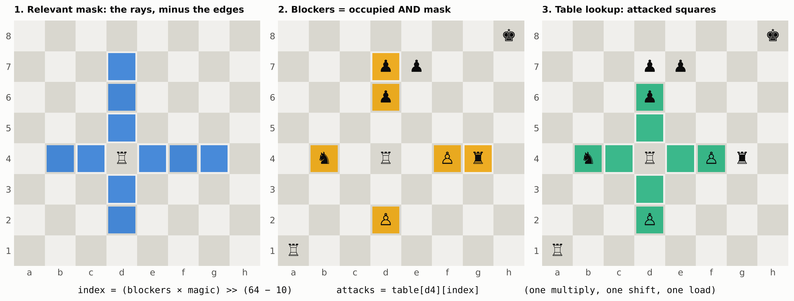
_Figure 1: A rook on d4 with $k = 10$ relevant squares. (1) The mask $M_s$. (2) Blockers $O \wedge M_s$. (3) The attack set read from the table. It includes our own pieces on f4 and d2; move generation removes them with $\wedge \lnot B_{\text{own}}$._

```cpp
static Bitboard rook_attacks(Square sq, Bitboard occupied) noexcept {
    const MagicEntry& m = rook_magics_[static_cast<size_t>(sq)];
    Bitboard occ = occupied & m.mask;
    size_t idx = static_cast<size_t>((occ * m.magic) >> m.shift);
    return m.attacks[idx];
}
```

### Zobrist hashing

Each position is identified by a 64-bit Zobrist key: an XOR of independent random 64-bit values $z_{p,s}$ for every (piece, square) pair present, plus values for side to move, castling rights and the en passant file. Because XOR is its own inverse, a move updates the key in $O(1)$: $K' = K \oplus z_{p,\text{from}} \oplus z_{p,\text{to}} \oplus \dots$. With full 64-bit keys stored in the table, a false match between two different positions has probability on the order of $2^{-64}$ per comparison, which is negligible at the roughly $10^{9}$ probes of a long game.

### Correctness by perft

Move generation is verified by perft: the exact count of leaf nodes of the legal-move tree at fixed depth. From the initial position, depth 6 has 119,060,324 leaves. Heaven's Gate matches the standard perft suite exactly, at 57 to 110 million leaves per second, and every change to the board code is checked against it first.

---

## 2. Search

### Negamax and the cost of exhaustive search

For a zero-sum game with alternating moves, the value of a position $x$ to the side to move satisfies the negamax recurrence

$$
V(x) = \max_{m \in \mathcal{M}(x)} \; -V(x \cdot m), \qquad V(x) = \text{eval}(x) \text{ at the horizon}.
$$

With branching factor $b \approx 35$, a depth-$d$ search visits $\Theta(b^d)$ nodes. Depth 6 is about $1.8 \times 10^9$.

### Alpha-beta and the Knuth-Moore bound

Alpha-beta carries a window $(\alpha, \beta)$: $\alpha$ is a score the side to move is already guaranteed elsewhere, $\beta$ a score the opponent will not allow. Once a move scores $\ge \beta$, the node's remaining moves are irrelevant, since the opponent will avoid reaching it.

```python
def alphabeta(board, depth, alpha, beta):
    if depth == 0:
        return evaluate(board)
    for move in ordered(board.legal_moves()):
        board.push(move)
        score = -alphabeta(board, depth - 1, -beta, -alpha)
        board.pop()
        if score >= beta:
            return score                # fail high: refutation found
        alpha = max(alpha, score)
    return alpha
```

The result equals the minimax value; only the work changes. Knuth and Moore showed that with perfect move ordering the number of leaves visited is

$$
b^{\lceil d/2 \rceil} + b^{\lfloor d/2 \rfloor} - 1.
$$

The argument classifies nodes into three types. At a PV node every child must be searched; at a cut node only the first (best) child is needed to produce a refutation; at an all node every child is searched, but each child is a cut node. Along any path the two non-PV types alternate, so only every second ply branches fully, and the tree behaves like one of depth $d/2$. The effective branching factor $\text{EBF} = (N_d / N_{d-2})^{1/2}$ drops from $b$ to roughly $\sqrt{b}$.

I measured this directly with a material-only evaluation on three middlegame positions:

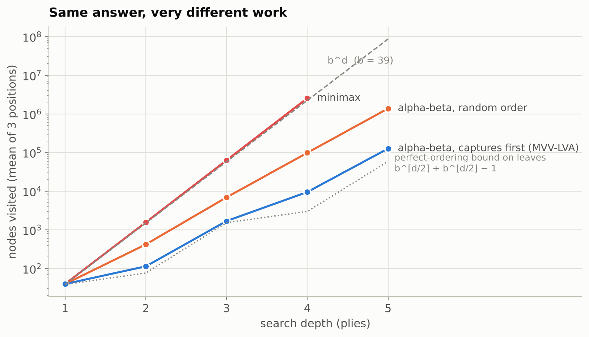
_Figure 2: Nodes visited (mean branching factor 39). At depth 4: minimax 2.5 million, alpha-beta with random move order 98,000, alpha-beta trying captures first by MVV-LVA 9,500. The dotted line is the Knuth-Moore bound on leaves._

The gap between random and ordered alpha-beta is a factor of ten at depth 4 and grows with depth. Heaven's Gate orders moves as: the transposition-table move, winning captures (by static exchange evaluation, then capture history), two killer moves per ply, the countermove to the opponent's previous move, castling, quiet moves by a weighted sum of history tables

$$
H(m) = h(m) + 2\,c_1(m) + c_2(m) + c_4(m) + \tfrac{1}{2} c_6(m),
$$

where $h$ is butterfly history and $c_k$ is continuation history indexed by the move $k$ plies earlier, and finally losing captures.

### Static exchange evaluation

SEE estimates the material outcome of a capture sequence on one square without making moves. With $g_0$ the value of the first victim, each recapture by the least valuable attacker gives

$$
g_k = v(\text{piece captured at step } k) - g_{k-1},
$$

and the result is folded back with the option to stop: $g_{k-1} \leftarrow -\max(-g_{k-1}, g_k)$. X-ray attackers are revealed by removing each capturing piece from the occupancy bitboard and recomputing slider attacks on the target square. The engine uses a thresholded form, `see_ge(move, t)`, which can stop early once the outcome is decided relative to $t$.

### Transposition table

The TT caches (best move, score, depth, bound type) per Zobrist key, four 16-byte slots per 64-byte cache line. With several threads sharing it, concurrent writes can tear an entry. The engine uses the Hyatt-Mann XOR scheme instead of locks: store $k \oplus d$ in place of the key $k$. A reader that observes data $d'$ from one write and $k \oplus d$ from another recovers $k \oplus d \oplus d' \ne k$ and treats the slot as a miss.

```cpp
struct TTSlot {
    std::atomic<uint64_t> key_xor{0};
    std::atomic<uint64_t> data{0};
    uint64_t load_key(uint64_t& data_out) const noexcept {
        data_out = data.load(std::memory_order_relaxed);
        return key_xor.load(std::memory_order_relaxed) ^ data_out;
    }
    void write(uint64_t key, uint64_t new_data) noexcept {
        data.store(new_data, std::memory_order_relaxed);
        key_xor.store(key ^ new_data, std::memory_order_relaxed);
    }
};
```

### Iterative deepening, PVS and aspiration windows

The engine searches depth $1, 2, 3, \dots$ until time runs out. Since the tree grows geometrically with ratio $\text{EBF} > 1$, the total cost is dominated by the last iteration, $\sum_{k \le d} N_k \approx N_d \cdot \frac{\text{EBF}}{\text{EBF} - 1}$, and earlier iterations pay for themselves by seeding the TT and history tables.

Principal variation search searches the first move with the full window and every later move with a null window $(\alpha, \alpha + 1)$, which only decides whether the move beats $\alpha$. A null-window search fails faster because it generates more cutoffs; only moves that fail high are re-searched with the full window. Aspiration windows start each iteration at $(v - \delta, v + \delta)$ around the previous score with $\delta = 19$ centipawns and grow $\delta$ by a factor of 1.5 on each failure.

### Quiescence search

At the horizon, a static evaluation in the middle of an exchange is meaningless. The quiescence search extends every leaf with captures (and all evasions in check) until the position is quiet, with the stand-pat score as a lower bound, since the side to move may decline to capture:

```cpp
int stand_pat = in_chk ? -ScoreInfinity : Evaluator::evaluate_fast(board, alpha, beta);
if (!in_chk) {
    if (stand_pat >= beta) return beta;
    if (stand_pat > alpha) alpha = stand_pat;
}
for (size_t i = 0; i < moves.size(); ++i) {
    MovePicker::pick_best(moves, scores, i);
    const auto& m = moves[i];
    if (!in_chk) {
        // SEE pruning: skip exchanges that lose material.
        if (!m.is_promotion() && !MoveGenerator::gives_check(board, m) && !MovePicker::see_ge(board, m, 0))
            continue;
        // Delta pruning: even winning the victim for free cannot reach alpha.
        if (stand_pat + victim_value(m) + 200 < alpha && !m.is_promotion()) continue;
    }
    board.make_move(m);
    int score = -quiescence_search(board, -beta, -alpha, ply + 1);
    board.unmake_move(m);
    // ... cutoff and alpha update ...
}
```

The stand-pat assumption is false in stalemate (no move to decline into), so the engine checks for a legal move before standing pat.

### Selectivity

Even perfectly ordered alpha-beta grows like $b^{d/2}$. Practical engines reach much greater depth by searching most moves to reduced depth or not at all. Each rule below is a bet that a cheaper search predicts the result of a full one.

**Null-move pruning** rests on the null-move observation: in most positions, having the move is an advantage. If the side to move passes and a reduced search still scores $\ge \beta$, a real move would very likely do so too:

```cpp
if (is_non_pv && depth >= 3 && !in_chk && eval >= beta &&
    static_eval >= beta - 20 * depth && board.has_non_pawn_material(us)) {
    int R = 3 + depth / 4 + std::min(3, (eval - beta) / nmp_margin);
    if (!improving) R += 1;
    R = std::clamp(R, 1, depth - 1);
    board.make_null_move();
    int null_score = -negamax_alphabeta(board, depth - 1 - R, ply + 1, -beta, -beta + 1, ...);
    board.unmake_null_move();
    if (null_score >= beta) {
        if (depth >= 12) { /* verification search, guards against zugzwang */ }
        else return beta;
    }
}
```

The observation fails in zugzwang, where every move worsens the position; that is common in pawn endings, hence the non-pawn-material condition and the verification search at high depth.

**Reverse futility pruning** returns early at depth $d \le 6$ when $\text{eval} - 70d \ge \beta$: the position is so far above $\beta$ that a shallow search is unlikely to drop below it. **Futility pruning** is the mirror for $\alpha$: at $d \le 4$, quiet moves are skipped when $\text{eval} + 185d \le \alpha$. Both margins were set by SPSA (Section 7).

**Late move reductions** exploit ordering quality. Move $m$ (1-indexed) at depth $d$ is searched at depth $d - 1 - r(d, m)$ with

$$
r(d, m) = 1 + \left\lfloor \frac{\ln d \cdot \ln m}{2.95} \right\rfloor - \left\lfloor \frac{H(m)}{8192} \right\rfloor + [\lnot\text{improving}] + [\text{TT move is a capture}] - [\text{PV node}],
$$

clamped to $[0, d - 2]$, and re-searched at full depth only if the reduced search beats $\alpha$:

```cpp
reduction = lmr_table[std::min(depth, 63)][std::min(i + 1, size_t(63))];
if (is_quiet) {
    reduction -= total_hist / 8192;
    if (!improving) reduction += 1;
    if (tt_move && tt_move.is_capture()) reduction += 1;
    if (!is_non_pv) reduction = std::max(0, reduction - 1);
}
reduction = std::clamp(reduction, 0, depth - 2);
score = -negamax_alphabeta(board, std::max(1, depth - 1 - reduction), ply + 1, -alpha - 1, -alpha, ...);
if (reduction > 0 && score > alpha)
    score = -negamax_alphabeta(board, depth - 1, ply + 1, -alpha - 1, -alpha, ...);
```

**Singular extensions** do the opposite. If the TT move has a reliable lower bound $s_{TT}$ and a search of all *other* moves at depth $(d-1)/2$ fails low against $s_{TT} - 2d$, the TT move is singular and is searched one ply deeper (two at PV nodes when it fails low by a wide margin). **Check extensions** add a ply when the side to move is in check, which keeps forcing sequences inside the horizon.

To quantify selectivity, I disabled null move and LMR through UCI options and measured nodes to complete each iteration on eight positions:

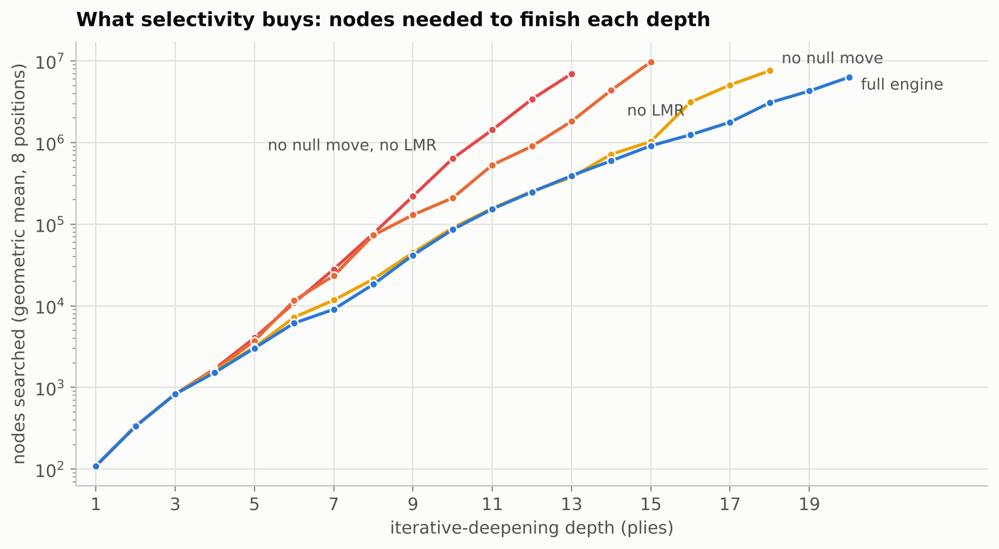
_Figure 3: Nodes to complete each depth, geometric mean over 8 positions. The full engine completes depth 13 in about 390,000 nodes and depth 20 in 6.3 million (EBF about 1.5 over the last four plies). Without null move and LMR, depth 13 costs 7.0 million (EBF about 2.4)._

Nodes-to-depth is a measure of tree shape, not strength: pruning changes what a given depth means. The only valid measure of a pruning rule is game results.

### Time allocation

Between iterations, the engine compares elapsed time to a soft limit, the optimum allocation scaled by three signals:

$$
t_{\text{soft}} = t_{\text{opt}} \cdot \sigma_{\text{stab}}(k) \cdot (1.5 - \phi) \cdot \operatorname{clip}\left(1 + \frac{\Delta v}{100},\ 0.9,\ 1.4\right),
$$

where $\sigma_{\text{stab}}(k) \in \{1.4, 1.2, 1.0, 0.9, 0.8\}$ decreases with the number of iterations $k$ the best move has stayed the same, $\phi$ is the fraction of the iteration's nodes spent on the best move, and $\Delta v$ is the score drop from the previous iteration. A stable, dominant best move ends the search early; a falling score extends it. This change alone measured +54 Elo.

---

## 3. The First Evaluator: Spectral Graphs and Tropical Algebra

The engine's original evaluation was not a list of chess rules. It treated the position as a weighted graph, extracted spectral invariants of its Laplacian, and fed them to a piecewise-linear function over the max-plus semiring. It is worth describing carefully, both because the mathematics is attractive and because the reasons it failed are instructive.

### The piece graph and its Laplacian

Let the $N \le 32$ pieces on the board be the vertices. Every pair $(i, j)$ is joined by an edge with weight

$$
w_{ij} =
\begin{cases}
\dfrac{1}{d_\infty(s_i, s_j)} + 1.5 \cdot [\text{slider aligned on a line}] & \text{same colour}, \\[2ex]
\dfrac{2\, v(p_j)}{d_\infty(s_i, s_j)} & \text{opposing colours},
\end{cases}
$$

where $d_\infty$ is the Chebyshev (king-move) distance and $v$ a piece value (pawn 1, knight 3, bishop 3.2, rook 5, queen 9, king 12). With adjacency $A = (w_{ij})$ and degree matrix $D = \operatorname{diag}(\sum_j w_{ij})$, the combinatorial Laplacian is $L = D - A$. Its quadratic form is

$$
u^\top L u = \sum_{i < j} w_{ij} (u_i - u_j)^2 \ge 0,
$$

so $L$ is symmetric positive semidefinite with eigenvalues $0 = \lambda_1 \le \lambda_2 \le \dots \le \lambda_N$, and $L\mathbf{1} = 0$.

From this the evaluator took:

- **the Fiedler value** $\lambda_2 = \min_{u \perp \mathbf{1},\, \|u\| = 1} u^\top L u$, the algebraic connectivity, interpreted as piece coordination, both for the whole graph and for each colour's subgraph;
- **a "spectral gap"** defined here as $\lambda_N - \lambda_2$;
- **the trace** $\operatorname{Tr}(L) = \sum_i D_{ii}$, interpreted as total pressure;
- plus aggregate features (king pressure, slider batteries, pawn cohesion, mobility, centre control, king shield, phase), 22 features in all.

The appeal is the Cheeger inequality, which ties $\lambda_2$ to the graph's bottleneck. For the conductance $h(G)$,

$$
\frac{\lambda_2}{2} \le h(G) \le \sqrt{2\, d_{\max}\, \lambda_2},
$$

so a small Fiedler value means the pieces split into weakly connected groups, which sounds exactly like "uncoordinated".

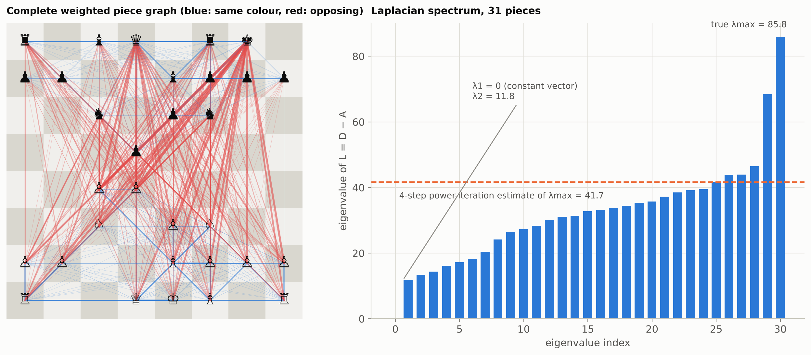
_Figure 4: Left: the complete weighted graph of a middlegame position (edge width proportional to $w_{ij}$). Right: its exact Laplacian spectrum, computed in double precision, against the engine's iterative estimate of $\lambda_{\max}$ (from a float32 reimplementation of the same iteration)._

### A post-mortem of the spectral features

Each of these features fails on mathematical grounds before any chess is played.

**The graph is complete, so connectivity carries no information.** Every pair of pieces has a positive edge, determined only by distance and piece type. It is not an attack graph: a rook behind its own pawn and a rook on an open file get the same weights. A complete graph with positive weights is always connected, so $\lambda_2 > 0$ in every position, and its magnitude mostly reflects how spread out the pieces are. On the four test positions I checked, $\lambda_2$ ranged from 5.1 (a sparse endgame) to 14.1 (a crowded middlegame), tracking piece count and density far more than anything resembling coordination.

**The trace is a sum of pairwise terms.** Since $\operatorname{Tr}(L) = \sum_i \sum_{j \ne i} w_{ij} = 2 \sum_{i<j} w_{ij}$, the "total pressure" feature is a fixed function of piece pairs and their distance, which a hand-crafted evaluation would express directly as a king-tropism or piece-pair table, at a fraction of the cost and with tunable weights per pair.

**The eigenvalue estimates were not converged.** The engine estimated $\lambda_{\max}$ with four steps of power iteration, then $\lambda_2$ with five steps of power iteration on the shifted matrix $\lambda_{\max} I - L$ after projecting out $\mathbf{1}$. Power iteration converges like $(\lambda_{N-1}/\lambda_N)^k$, which for these spectra (clusters of near-equal eigenvalues, Figure 4) is nowhere near converged after four or five steps. Worse, the first iteration starts from $v_0 = \mathbf{1}/\sqrt{N}$, which is *exactly* the eigenvector of $\lambda_1 = 0$, so in exact arithmetic $L v_0 = 0$ and the iteration has nothing to amplify; in floating point it escapes only through rounding error. On my test positions, a float32 reimplementation gave $\lambda_{\max} = 41.7$ against a true 85.8 on one position, and $\lambda_2 = 0$ against a true 11.8 on the same position.

**The edge weights depend on vertex order.** The opposing-colour weight uses the value of the second endpoint, $v(p_j)$, and the code computes each edge once for $i < j$ in square order. Since White's pieces usually occupy lower squares, a White-Black pair is weighted by the Black piece's value regardless of which piece is attacking, which breaks the colour symmetry an evaluation must have.

### The tropical surface

The 22 features $x \in \mathbb{R}^{22}$ were mapped to a score by a tropical polynomial. In the max-plus semiring $(\mathbb{R} \cup \{-\infty\}, \oplus, \otimes)$ with $a \oplus b = \max(a, b)$ and $a \otimes b = a + b$, a tropical polynomial in $x$ is

$$
T(x) = \bigoplus_{j=1}^{M} \left( b_j \otimes x_1^{\otimes a_{j1}} \otimes \dots \otimes x_k^{\otimes a_{jk}} \right) = \max_{1 \le j \le M} \left( w_j^\top x + b_j \right).
$$

The evaluator used $M = 64$ such affine "sectors" per king bucket, with 10 buckets (5 regions of the opponent king's position, mirrored, for each side to move): $640 \times (22 + 1) = 14{,}720$ parameters. To make it differentiable for training, the hard maximum was replaced by a temperature-$\tau$ log-sum-exp with $\tau = 3$:

$$
T_\tau(x) = \tau \log\left( \frac{1}{M} \sum_{j=1}^{M} e^{(w_j^\top x + b_j)/\tau} \right).
$$

Three properties of this form decide its fate.

**It is convex in $x$.** A maximum of affine functions is convex, and so is log-sum-exp. Along any feature, the score can only bend upward. An evaluation must often bend the other way: the value of advancing a pawn storm, of king pressure against one's own exposure, or of piece activity versus safety rises and then falls. A convex model cannot represent an interior optimum in any direction.

**The smoothing adds a position-dependent bias.** Writing $y_j = w_j^\top x + b_j$, the bounds $\frac{1}{M} e^{\max_j y_j/\tau} \le \frac{1}{M}\sum_j e^{y_j/\tau} \le e^{\max_j y_j/\tau}$ give, after taking $\tau \log$,

$$
\max_j y_j - \tau \log M \;\le\; T_\tau(x) \;\le\; \max_j y_j .
$$

With $\tau = 3$ internal units, $M = 64$ and the output scaled by 10 into centipawns, the gap is up to $10 \cdot 3 \ln 64 \approx 125$ centipawns, and where in that range the score lands depends on how many sectors happen to be close to the maximum, which has nothing to do with chess.

**It is a neural network in disguise.** Since $\max(a, b) = b + \operatorname{ReLU}(a - b)$, a maximum over 64 affine functions is a ReLU network of depth $\lceil \log_2 64 \rceil = 6$, and more generally every ReLU network computes a difference of two tropical polynomials (Zhang, Naitzat and Lim). The "no neural network" engine began as a small hand-structured network with an eigensolver in front of it. It also inherited the training pathology of one: under the hard maximum, a gradient reaches only the winning sector, so sectors that never win stop learning, the analogue of dead ReLU units.

### What happened to it

The audit that started the strength work found that the spectral-tropical evaluator was not reachable from the playing search in any mode, and its weights file was not in the repository. Every Elo point the engine had came from the classical code path, which is the subject of the rest of this writeup.

---

## 4. The Linear Evaluation

The evaluation that plays is a sum of hand-designed terms: material, piece-square tables, pawn structure (doubled, isolated, backward, connected, phalanx, passed pawns by rank with blocker, free-path and king-distance terms), mobility, king safety (shield, storms, open files, weighted king-zone attackers, safe checks), threats, outposts, rook placement, bishop pair, material imbalance and endgame scaling.

### Tapered evaluation

Every term has a middlegame weight and an endgame weight. With game phase $\varphi \in [0, 24]$ computed from remaining material (minor 1, rook 2, queen 4), the score is

$$
e(x) = \frac{\text{mg}(x) \cdot \varphi + \text{eg}(x) \cdot s(x) \cdot (24 - \varphi)}{24} + \text{tempo}(\varphi),
$$

where $s \in [0, 1]$ scales the endgame component for configurations that are drawish whatever the material count says: opposite-coloured bishops ($s = 1/2$ or $3/4$), two knights against a bare king ($s = 0$), a minor piece up without pawns ($s = 0$ or $1/8$).

```cpp
int Evaluator::evaluate_fast(const Board& board, int alpha, int beta) {
    const int phase = std::min(24, board.game_phase());
    const int tempo = (g_eval_params.tempo_mg * phase + g_eval_params.tempo_eg * (24 - phase)) / 24;

    // Lazy cutoff: incrementally maintained material + PST far outside the window.
    const int simple = /* tapered material + PST, side-relative */;
    if (simple >= beta + 320 || simple <= alpha - 320) return simple;

    const ScorePair w = side_totals(board, Color::White), b = side_totals(board, Color::Black);
    const int mg = w.mg - b.mg, eg = w.eg - b.eg;
    const int scaled_eg = eg * eg_scale(board, eg) / 64;
    const int white_score = (mg * phase + scaled_eg * (24 - phase)) / 24;
    return (board.side_to_move() == Color::White) ? white_score + tempo : -white_score + tempo;
}
```

Material and piece-square sums are updated incrementally in `make_move`. Pawn terms depend only on the pawn bitboards, so they are cached in a per-thread pawn hash table. The lazy cutoff returns the cheap estimate when it is already decisive relative to the window; removing it cost 35 Elo.

### Linearity as a design constraint

Every term is either (count) $\times$ (weight) or a table entry selected by a count. Mobility, for instance, is a lookup with one weight per number of safe squares:

```cpp
auto add_mob = [&](PieceType pt, const auto& mg_tab, const auto& eg_tab, auto attack_fn) {
    for (Bitboard pieces = board.pieces(make_piece(side, pt)); pieces;) {
        Square psq = pop_lsb(pieces);
        const size_t count = std::min<size_t>(popcount(attack_fn(psq, occ) & safe_mask), mg_tab.size() - 1);
        score.mg += mg_tab[count];
        score.eg += eg_tab[count];
    }
};
```

A table is a one-hot encoding: it is linear in its parameters while representing an arbitrary function of the count, including the concave shapes the tropical model could not express. The whole evaluation is therefore linear in its parameter vector $w \in \mathbb{Z}^{1158}$, before tapering:

$$
\text{mg}(x) = \sum_j c^{\text{mg}}_j(x)\, w_j + r^{\text{mg}}(x), \qquad \text{eg}(x) = \sum_j c^{\text{eg}}_j(x)\, w_j + r^{\text{eg}}(x),
$$

with integer coefficients $c_j(x)$ and residuals $r(x)$ for fixed constants. This property is what makes exact fitting possible.

---

## 5. Fitting 1,158 Weights

### The Texel objective

Texel tuning, introduced by Peter Österlund for his engine Texel, treats the evaluation as a predictor of the expected game score through a logistic link,

$$
\sigma(e) = \frac{1}{1 + 10^{-K e / 400}},
$$

and minimises the mean squared error against targets $y_i \in [0, 1]$:

$$
\mathcal{L}(w) = \frac{1}{N} \sum_{i=1}^{N} \left( y_i - \sigma(e_w(x_i)) \right)^2 .
$$

$K$ is fitted first, by ternary search on the starting weights, and then held fixed; for the current data $K = 0.897$.

### An exact linear model by finite differences

The usual failure mode of a tuner is a reimplementation of the evaluation that drifts from the engine's. Heaven's Gate's tuner never reimplements anything. Since the evaluation is linear in $w$, each coefficient is a finite difference that can be *measured* by calling the engine's own evaluation function:

$$
c_j(x) = e_{w + \mathbf{e}_j}(x) - e_w(x),
$$

computed separately for the middlegame and endgame components, before tapering:

```cpp
const ScorePair base = white_terms(b);              // the engine's real positional terms
for (size_t j = fd_begin; j < params.size(); ++j) {
    int* ptr = params[j].engine_ptr;                // points into the live eval parameters
    *ptr += 1;
    const ScorePair bumped = white_terms(b);
    *ptr -= 1;
    const int cm = bumped.mg - base.mg, ce = bumped.eg - base.eg;
    if (cm || ce) { acc[j].first += cm; acc[j].second += ce; }
}
```

Material, piece-square and tempo coefficients come directly from piece placement. The result is a sparse design matrix: 99 million nonzero coefficients over 1.56 million positions, about 64 per position. A `--parity` mode asserts that the model reproduces the engine's evaluation to within $10^{-6}$ centipawns, both at the current weights and after random integer perturbations of them, which verifies linearity itself. Adding a non-linear term makes parity fail and the tuner refuse to run.

With $p_i = \sigma(e_i)$ and $\frac{d\sigma}{de} = \frac{K \ln 10}{400}\, \sigma (1 - \sigma)$, the gradient is

$$
\frac{\partial \mathcal{L}}{\partial w_j} = -\frac{2}{N} \sum_i (y_i - p_i)\, p_i (1 - p_i)\, \frac{K \ln 10}{400} \left( c^{\text{mg}}_j(x_i) \frac{\varphi_i}{24} + c^{\text{eg}}_j(x_i)\, s_i \frac{24 - \varphi_i}{24} \right),
$$

and the tuner runs full-batch Adam ($\beta_1 = 0.9$, $\beta_2 = 0.999$, step 0.5) over the sparse matrix, keeping the weights with the lowest validation error.

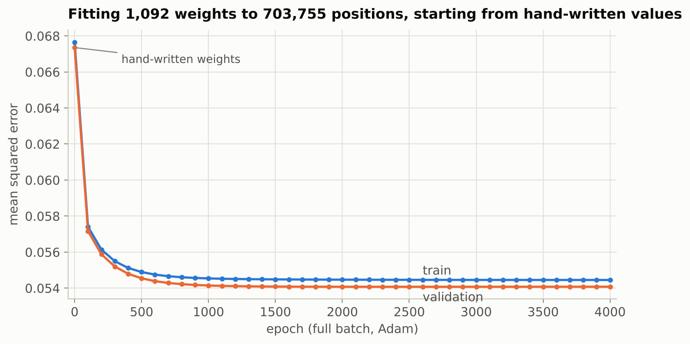
_Figure 5: The first fit, of 1,092 weights on 703,755 quiet positions labelled with game results, from hand-written starting values. Validation MSE fell from 0.0674 to 0.0541. That build won its first test by **+218 Elo** over 160 games, the largest single gain in the engine's history._

### What the fit learned

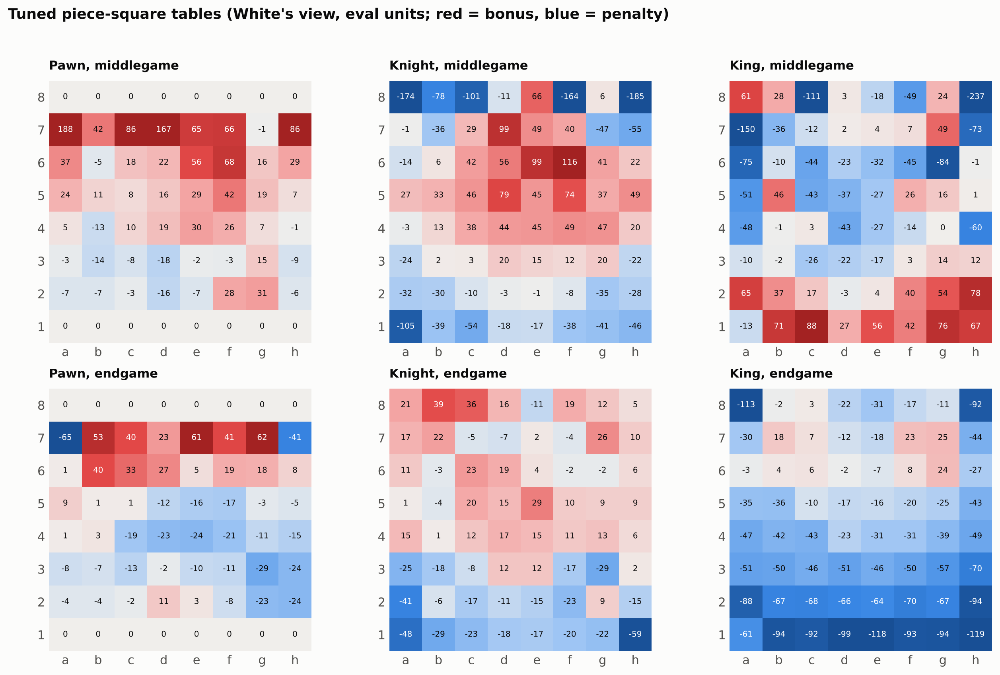
_Figure 6: Tuned piece-square tables. Knights favour advanced central squares (f6 +116, e6 +99 in the middlegame) and avoid the rim; the middlegame king prefers b1, c1 and g1._

Two properties of the fitted tables matter for interpretation. Rarely observed squares are poorly constrained (a knight on h8 at -185 reflects almost no data, not chess knowledge). And the tables are not identifiable in isolation: features are correlated, so the endgame king table can be negative near its own back rank because king-distance terms elsewhere already reward activity. Only the sum is meaningful.

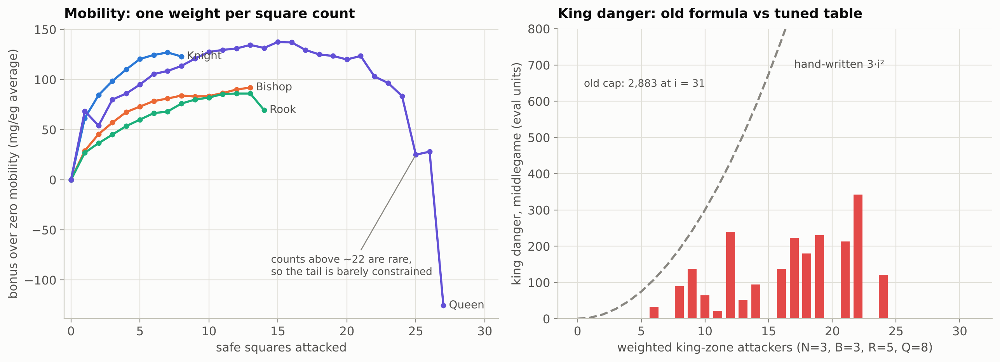
_Figure 7: Left: fitted mobility tables, strongly concave in the number of safe squares. Right: the previous hand-written king-danger formula $3i^2$ in weighted attackers (one queen near the king cost 192 centipawns; the cap was 2,883) against the fitted table, which stays below 350 and is zero for attacker sums that rarely occur._

### Validation loss is not strength

Two later batches of terms (space, pawn islands, king-pawn distance, connected passers, long diagonals, a tunable imbalance, minor pieces behind pawns, king threats and others) each lowered validation error and gained nothing: -14 and 0 Elo over 240 games. Game-result labels are a high-variance target. A position from a game White eventually lost may have been winning for White, so the label noise is of the same order as the signal, and additional features fit the noise. Self-play labels were worse: 1.9 million positions from fast self-play cost 31 Elo, and the fit pulled the rook's endgame value from 717 to 560, because fast games fail to convert won endgames.

The fix was a better target. Positions were relabelled with Stockfish's score $c$ at 5,000 to 20,000 nodes, blended with the game result,

$$
y = 0.8 \cdot \frac{1}{1 + 10^{-c/400}} + 0.2 \cdot r,
$$

keeping only quiet positions (best move not a capture, $|c| \le 1500$). With identical features, this gained **+50 Elo**, material values came out sensible (rook 676/680, queen 1494/1030 in mg/eg), and validation MSE fell to about 0.020, on a different scale because the target variance is much lower. The current fit adds 635,620 positions harvested from about 10,700 of the engine's own games, for 1.56 million positions in total, which concentrates the data on positions the engine actually reaches.

---

## 6. Measurement

### Why measurement comes first

The early versions of the project reported ratings of "2800" and "3400". An audit replayed every game in the repository and found that these did not survive scrutiny: the "3400" came from seven games ended early by a mate-score adjudication, with +800 assigned to a perfect score, and the opponents were Stockfish with its strength limiter, which is a handicap target rather than an independent anchor. The first anchored measurement, 400 games against four Blunder releases with published CCRL Blitz ratings at 10+0.1 with every opening played from both sides, gave **2361**.

### Elo and the pentanomial model

For a score fraction $p$, the logistic Elo difference is

$$
\Delta E = -400 \log_{10}\left( \frac{1}{p} - 1 \right), \qquad \frac{d\,\Delta E}{dp}\Big|_{p = 1/2} = \frac{1600}{\ln 10} \approx 695,
$$

so near equality one percentage point of score is about 7 Elo. Useful changes to a mature engine are worth +5 to +20 Elo, a shift of one to three points.

Every opening is played twice with colours reversed, and the two games are strongly correlated through the opening's bias. The harness therefore treats each pair as one observation with five outcomes, $X \in \{0, \tfrac14, \tfrac12, \tfrac34, 1\}$ (the pentanomial model), and estimates

$$
\hat\mu = \frac{1}{n} \sum_k X_k, \qquad \hat\sigma^2 = \frac{1}{n} \sum_k (X_k - \hat\mu)^2 .
$$

Pairing removes the opening variance from the estimate; treating the games as independent would overstate the precision.

### The sequential test

The harness runs a sequential probability ratio test in the normal approximation used by Stockfish's Fishtest. In normalized Elo, hypotheses $H_0: \text{nElo} = 0$ and $H_1: \text{nElo} = 20$ map to pair means $\mu_h = \tfrac12 + \tfrac{\text{nElo}_h}{\kappa} \sqrt{2}\, \sigma$ with $\kappa = 800 / \ln 10$. For Gaussian observations with common variance, the log-likelihood ratio after $n$ pairs reduces to

$$
\Lambda_n = \frac{n\, (\mu_1 - \mu_0)\, (2 \hat\mu - \mu_0 - \mu_1)}{2 \hat\sigma^2},
$$

and the test stops when $\Lambda_n$ leaves $(\ln \tfrac{\beta}{1-\alpha}, \ln \tfrac{1-\beta}{\alpha}) = (-2.94, 2.94)$ for error rates $\alpha = \beta = 0.05$:

```python
def stats(p):                                   # p = pair-score counts for [0, .25, .5, .75, 1]
    n = sum(p); xs = [0, .25, .5, .75, 1]
    mu = sum(x * c for x, c in zip(xs, p)) / n
    var = sum(c * (x - mu) ** 2 for x, c in zip(xs, p)) / n
    sg = math.sqrt(2 * var)                     # per-game std implied by the pair variance
    mu0, mu1 = 0.5 + elo0 / K * sg, 0.5 + elo1 / K * sg   # K = 800 / ln 10
    llr = n * (mu1 - mu0) * (2 * mu - mu0 - mu1) / (2 * var)
    return n, mu, var, llr
```

All tests used fastchess at 8 s + 0.08 s per move, one thread, 16 MB hash, the UHO_4060_v4 book with both colours per opening, no adjudication, in restart-safe chunks of 40 games. The merge rule was stricter than the SPRT: the 95% confidence interval had to lie entirely above zero.

### Resolution and the stacking argument

At these settings, 240 games give a 95% half-width of about 30 Elo. Since the standard error scales as $n^{-1/2}$, resolving an effect of size $\delta$ needs roughly

$$
n(\delta) \approx 240 \left( \frac{30}{\delta} \right)^2 \text{ games},
$$

about 1,500 games for $\delta = 12$. When two independent changes have effects $\delta_1, \delta_2$ of the same sign, testing them together needs $n(\delta_1 + \delta_2)$, a factor of about 4 fewer games than either alone. Stacking two well-motivated near-misses resolved twice in this project:

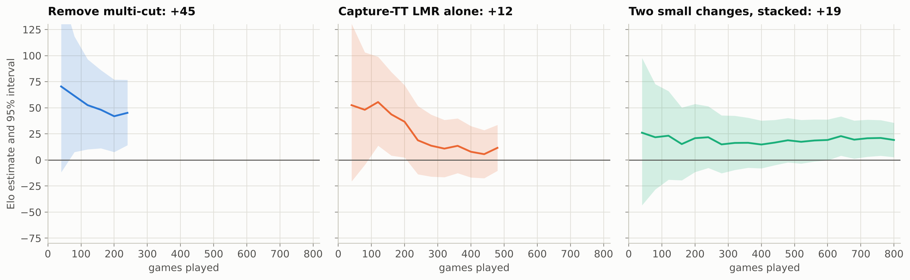
_Figure 8: Running estimate with 95% interval. Left: removing classic multi-cut cleared zero within 80 games, ending at +45 [+14, +77]. Middle: one LMR change alone stayed unresolved at +12 [-10, +34] after 480 games. Right: the same change stacked with a null-move condition resolved at +19 [+3, +36] over 800 games._

### Results

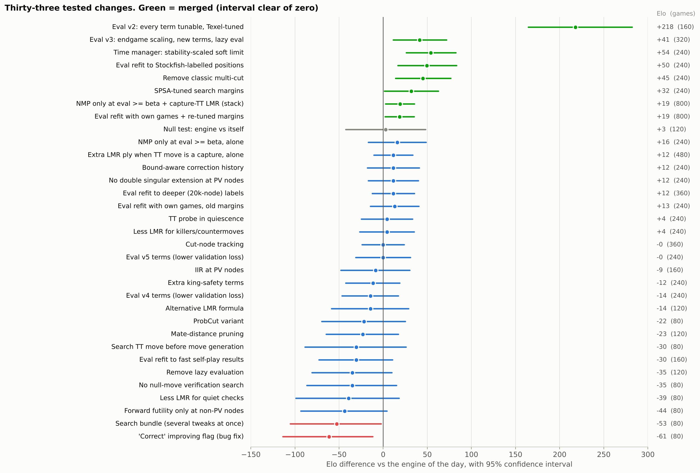
_Figure 9: Thirty-three candidates, each against the engine of its day; eight merged. The null test (the engine against itself) measured +3, as a fair harness should._

Several regularities stand out:

- **Most changes are neutral or harmful.** Techniques standard in strong engines (mate-distance pruning, TT probes in quiescence, IIR at PV nodes, cut-node tracking) did not transfer. A heuristic's value depends on the rest of the search.
- **Correctness and strength are different properties.** The `improving` flag compared the static evaluation with a stale value from a sibling node. Fixing it cost **61 Elo**, because every pruning margin had been tuned against the buggy flag; the corrected flag pruned less and the search used 33% more nodes per depth.
- **Bundled changes are uninterpretable.** A bundle of search tweaks lost 53 Elo with no way to attribute the loss.
- **Deletion is a valid change.** The largest search gain, +45, removed a multi-cut pass that duplicated work already done by singular extensions.

Tests run on two cores at fast time controls are sensitive to background load. One test, run while a forgotten SPSA job shared the CPU, lost 31 of 120 games on time and was discarded. Every test PGN is now checked for time forfeits before its result is used; all merged results had none.

---

## 7. Tuning the Search with SPSA

Search margins affect play only through the tree, so they cannot be fitted to labelled positions. They were tuned with simultaneous perturbation stochastic approximation. Let $f(\theta)$ be expected match score. Each iteration draws $\Delta \in \{-1, +1\}^n$ uniformly and plays a short match between $\theta + c\Delta$ and $\theta - c\Delta$. Since $\mathbb{E}[\Delta_i \Delta_j] = \delta_{ij}$, a Taylor expansion gives

$$
\mathbb{E}\big[ (f(\theta + c\Delta) - f(\theta - c\Delta))\, \Delta_i \big] = 2c\, \frac{\partial f}{\partial \theta_i} + O(c^3),
$$

so the match result $W - L$ times $\Delta$ is an unbiased (up to $O(c^2)$) estimate of the gradient direction from a single match, whatever the dimension $n$. The update is

$$
\theta \leftarrow \theta + r_k\, c\, (W - L)\, \Delta, \qquad r_k = \frac{r_0}{(1 + k/400)^{0.3}} .
$$

```python
for k in range(k0 + 1, k0 + 1 + ITERS):
    delta = {n: random.choice((-1, 1)) for n in names}
    plus  = {n: theta[n] + P[n][1] * delta[n] for n in names}
    minus = {n: theta[n] - P[n][1] * delta[n] for n in names}
    W, L = play(plus, minus, games=8, tc="5+0.05")       # paired openings, colours reversed
    r_k = R0 / (1 + k / 400) ** 0.3
    for n in names:
        theta[n] = clamp(theta[n] + r_k * P[n][1] * (W - L) * delta[n])
```

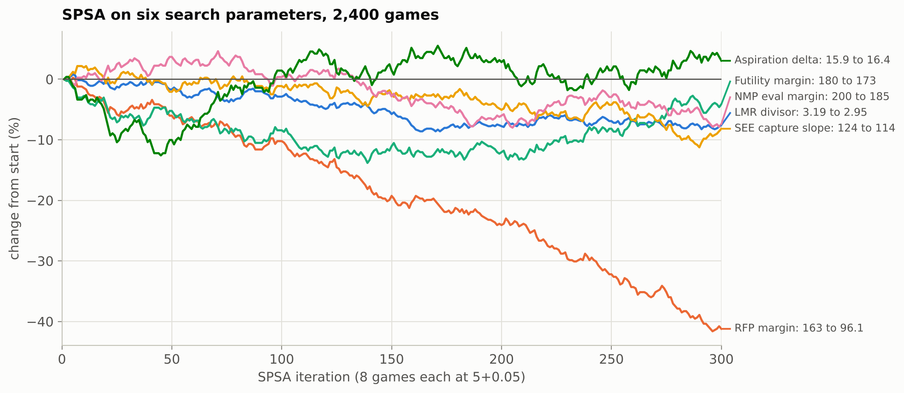
_Figure 10: 300 iterations (2,400 games) over six parameters. The reverse futility margin moved from 163 to 96 per ply; the rest changed by 10% or less. Result: **+32 Elo** [+2, +63]._

Evaluation and search parameters are coupled. Pruning margins are thresholds on the evaluation's scale, and a refit changes both the scale and the balance between terms. When the evaluation was refitted on the engine's own games, the refit alone measured +13 [-14, +40]. After a second SPSA run on the margins for the new evaluation (reverse futility moved again, from 96 to 70), the pair measured **+19 [+2, +35]** over 800 games.

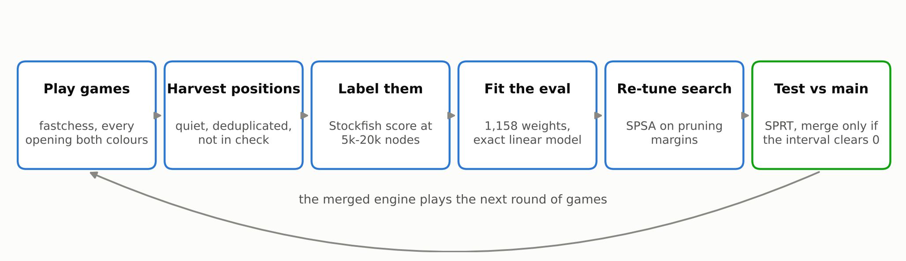
_Figure 11: The improvement loop. Games become training positions, Stockfish labels them, the tuner refits the evaluation, SPSA refits the search margins, and the candidate must pass the sequential test against the current version._

---

## 8. Results and Limitations

Self-play results measure progress relative to a previous version, not absolute strength. Absolute strength was measured with fixed anchors: Blunder 7.6 (CCRL Blitz 2631) at 10+0.1, and Stockfish with `UCI_Elo` 2800, 3000 and 3190 at 60+0.6, the control at which its limiter is calibrated. A pooled maximum-likelihood fit over all anchor games gives the rating:

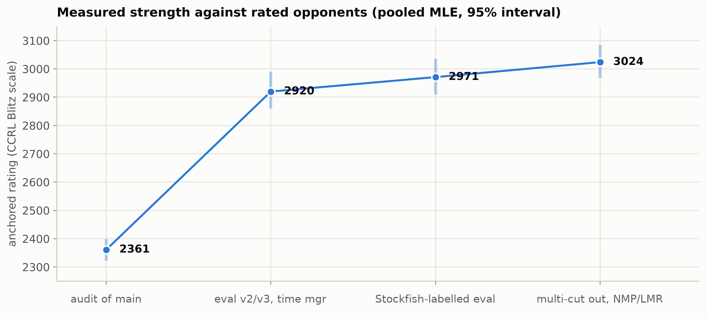
_Figure 12: Anchored ratings with 95% intervals at each stage. The latest measured build scored 91% against Blunder 7.6 and 48.8% against Stockfish at 3000, pooling to 3024 (2967 to 3084), with no time forfeits in 220 games._

Two changes merged after that measurement (+32 and +19 in self-play) suggest the current build is somewhat higher; self-play gains usually shrink against other opponents, so no number is claimed until the next anchor match. A check at 2+1 of the engine before and after two merges measured +108 over 40 games, so the fast-control gains carry over to slower play. The anchors were measured on local hardware rather than by CCRL, which adds perhaps 50 to 100 Elo of systematic uncertainty to the absolute figure; the relative progress, 2361 to 3024 under identical conditions, is the robust result.

### Error analysis

Every loss against the anchors was analysed with Stockfish, flagging moves that reduced Heaven's Gate's win probability by at least 20 points. Of 43 such mistakes, only 9 were missed tactics; the rest were quiet positional misjudgments, mostly in heavy middlegames.

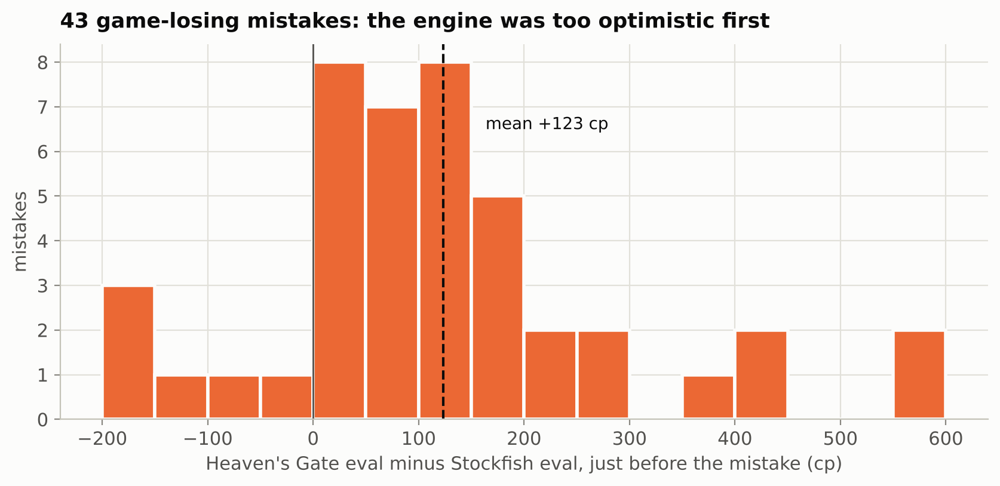
_Figure 13: Heaven's Gate's evaluation minus Stockfish's immediately before each of 43 game-losing mistakes (on an earlier build). The mean bias is +123 centipawns; half exceed one pawn._

The engine does not lose for lack of calculation. It loses by overvaluing positions, chiefly through king safety and piece activity in complex middlegames. This is the central limitation of a linear evaluation: terms combine additively, so an interaction such as "this king is safe unless the knight reaches g5 and the h-file opens" must be written in explicitly as a new feature. A network learns such products from data. A hand-crafted evaluation can only approximate them one feature at a time.

---

## Conclusion

A hand-crafted engine, done carefully, is a linear model with about a thousand weights, fitted exactly to millions of labelled positions, running under a search whose margins are tuned by stochastic approximation and whose every change must pass a sequential test. The more elaborate first design, graph spectra feeding a tropical surface, failed for reasons that were visible in the mathematics: a complete graph has no connectivity structure to measure, unconverged power iterations do not estimate eigenvalues, and a convex model cannot express an interior optimum.

Most of the measured strength came from the plain parts. The +218 came from fitting weights that already existed, the +54 from allocating time better, and the +45 from deleting code. The common thread is that a number without a confidence interval is not a measurement, and a measurement against your own previous version is not a rating.

What I think is genuinely distinctive about Heaven's Gate is not any single feature but how much of it can be checked. The evaluation is a readable list of chess ideas with fitted weights, the tuner is provably consistent with the engine it tunes, every merged change has an interval attached, every rejected change is on record, and the rating rests on independently rated opponents. That is a different kind of achievement from raw strength: an engine near 3000 where you can point at any number in it and say where it came from and how much it is worth. In an era where the strongest engines are trained black boxes, a strong engine that is fully explainable seemed worth building, and worth writing up.

The engine is open source at [github.com/Weptune/Heavens-Gate](https://github.com/Weptune/Heavens-Gate).

### References

- D. Knuth and R. Moore, "An Analysis of Alpha-Beta Pruning", *Artificial Intelligence* 6, 1975
- F. Chung, *Spectral Graph Theory*, CBMS Regional Conference Series in Mathematics 92, AMS
- L. Zhang, G. Naitzat and L.-H. Lim, "Tropical Geometry of Deep Neural Networks", ICML 2018
- J. C. Spall, "Multivariate Stochastic Approximation Using a Simultaneous Perturbation Gradient Approximation", *IEEE Transactions on Automatic Control* 37, 1992
- [Texel's Tuning Method](https://www.chessprogramming.org/Texel%27s_Tuning_Method), Chess Programming Wiki
- [Fishtest mathematics](https://github.com/official-stockfish/fishtest/wiki/Fishtest-mathematics), for the GSPRT and pentanomial model
- [Stockfish (chess)](https://en.wikipedia.org/wiki/Stockfish_(chess)), for the NNUE history
- [CCRL testing methodology](https://computerchess.org/about.html)
