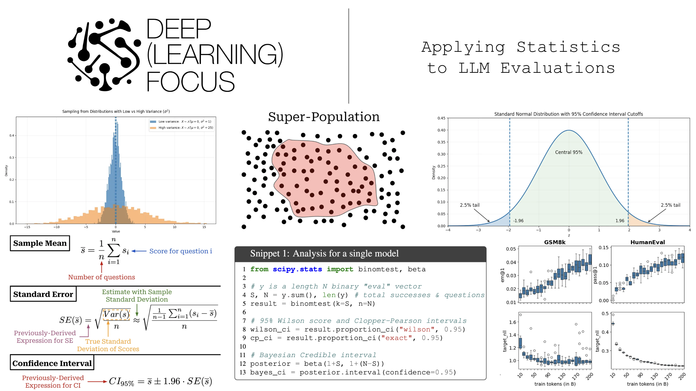

Research on large language models (LLMs) is empirically driven. For this reason, model evaluations play a pivotal role in the field's progress. We improve models by making changes, evaluating them, and iterating. Despite their foundational role, however, evaluations are usually handled in a naive manner. In most cases, we just test a model's performance over a finite evaluation dataset and directly compare performance metrics to those of other models with no consideration for whether these results are statistically significant or not. Such an approach leads to incorrect or misleading interpretations of evaluation results. As researchers, we want to avoid mistaking noise for progress and instead equip ourselves with the statistical tools needed to run informative model evaluations.

> "Language models are measured in the literature by evaluations, or evals. Evals are commonly run and reported with a highest number is best mentality; industry practice is to highlight a state-of-the-art result in bold, but not necessarily to test that result for any kind of statistical significance." - from [1]

In this overview, we will build a statistical foundation for LLM evaluations from the ground up. To begin, we will review basic statistical ideas with a practical focus on the topics that are most useful for model evaluations. We will then take a deeper look at how these ideas can be directly used to interpret LLM evaluation results in an uncertainty-aware manner. Specifically, we will cover a set of statistical best practices for model evaluation and implement each of them to show how they can be concretely applied. Although it may seem daunting, taking a statistically grounded approach to model evaluation is not especially complex, and adopting these ideas allows us to accelerate our research progress by avoiding spurious results.

---

## Basic Statistics for LLM Evaluations

In order to develop a statistical framework for LLM evaluations, we first need to review a few fundamental concepts in statistics. These concepts form the basic foundation that we will build upon throughout this overview.

### Random Variables and Estimators

A random variable $X$ is defined as a quantity that has a value dependent upon chance. We can observe values of this random variable by sampling from its probability distribution. If we draw $n$ observations from this distribution, these observations are denoted as $x_1, x_2, \dots, x_n$. For our purposes, each of these observations will be sampled from the distribution of $X$ (i.e., $x_i \sim X$). We define the mean (or average) of this random variable as $\mathbb{E}[X] = \mu$. In practice, we rarely know the true value of $\mu$. Instead, we must estimate $\mu$ by computing the sample mean $\bar{x}$ over our $n$ sampled observations:

$$\mu = \mathbb{E}[X], \qquad \bar{x} = \frac{1}{n} \sum_{i=1}^n x_i$$

Formally, the lower case letters $x_i$ represent concrete values sampled from a distribution, while upper case letter $X_i$ denotes the $i$-th random variable in our sample - this is a notational detail, but it is important! The sample mean $\bar{x}$ is a realized value computed from our sample of numbers, whereas the sample mean estimator $\bar{X}$ is a random variable that is a function of the random variables $X_1, X_2, \dots, X_n$:

$$\bar{X} = \frac{1}{n} \sum_{i=1}^n X_i$$

The distribution of our random variable $X$ also has variance $\text{Var}(X)$, which describes how spread out the distribution is. Variance is defined as the expected squared deviation from the mean:

$$\text{Var}(X) = \sigma^2 = \mathbb{E}\left[(X - \mu)^2\right] = \mathbb{E}[X^2] - \mu^2$$

In this overview, we will assume that this variance is finite (i.e., less than infinity). If we have a distribution with high variance, then observations sampled from this distribution are widely spread out, whereas a distribution with low variance will have samples that are closely clustered around the mean.

Similarly to the sample mean, we can also estimate the variance of a distribution from a sample of observations by computing the sample variance $s^2$:

$$s^2 = \frac{1}{n - 1} \sum_{i=1}^n (x_i - \bar{x})^2$$

The standard deviation of $X$ is simply the square root of the variance:

$$\sigma = \sqrt{\text{Var}(X)}, \qquad s = \sqrt{s^2}$$

While variance measures the variability of a single random variable $X$, covariance measures how two random variables $X$ and $Y$ vary together:

$$\text{Cov}(X, Y) = \mathbb{E}\left[(X - \mu_X)(Y - \mu_Y)\right] = \mathbb{E}[XY] - \mu_X \mu_Y$$

We can also estimate covariance from a paired sample of observations using the sample covariance:

$$\widehat{\text{Cov}}(X, Y) = \frac{1}{n - 1} \sum_{i=1}^n (x_i - \bar{x})(y_i - \bar{y})$$

If covariance is positive, then $X$ and $Y$ tend to move in the same direction. If covariance is negative, then $X$ and $Y$ tend to move in opposite directions. If $X$ and $Y$ are independent, then their covariance is zero.

The law of total variance is a useful identity that decomposes the variance of a random variable $Y$ into two parts based on conditioning on another random variable $X$:

$$\text{Var}(Y) = \mathbb{E}\left[\text{Var}(Y \mid X)\right] + \text{Var}\left(\mathbb{E}[Y \mid X]\right)$$

When evaluating an LLM, we can think of our score as a random variable that has variance due to two sources:
1. Variability due to the question sampled for evaluation.
2. Within-question variability arising from stochastic generation by the LLM or an LLM judge.

The law of total variance allows us to formally separate and reason about both of these sources of variance.

---

### Standard Error and Sample Means

If we repeatedly draw samples from $X$ and compute the sample mean, we will get a different result each time. The resulting sample means form a sampling distribution (i.e., basically a list of sample means we have drawn). The standard error captures variability in the sample mean estimator (i.e., the spread of sample means after computing it multiple times). We can compute the standard error as shown below:

$$\text{SE}(\bar{X}) = \frac{\sigma}{\sqrt{n}}, \qquad \widehat{\text{SE}}(\bar{X}) = \frac{s}{\sqrt{n}}$$

This standard error equation makes the assumption that samples drawn from $X$ are independent and identically distributed (IID). Independence implies that $\text{Cov}(X_i, X_j) = 0$ for $i \neq j$, and identical distribution implies that each $X_i$ has the same variance $\text{Var}(X_i) = \sigma^2$. Given these assumptions, we can derive the standard error expression as follows:

$$\text{Var}(\bar{X}) = \text{Var}\left(\frac{1}{n} \sum_{i=1}^n X_i\right) = \frac{1}{n^2} \text{Var}\left(\sum_{i=1}^n X_i\right)$$

Within this derivation, we use the variance of a sum identity, which can be generally expressed as:

$$\text{Var}\left(\sum_{i=1}^n X_i\right) = \sum_{i=1}^n \text{Var}(X_i) + 2 \sum_{1 \le i < j \le n} \text{Cov}(X_i, X_j)$$

Since the variables are independent, the covariance term is zero, yielding:

$$\text{Var}(\bar{X}) = \frac{1}{n^2} \sum_{i=1}^n \text{Var}(X_i) = \frac{1}{n^2} \sum_{i=1}^n \sigma^2 = \frac{n \sigma^2}{n^2} = \frac{\sigma^2}{n}$$

Taking the square root gives our standard error:

$$\text{SE}(\bar{X}) = \sqrt{\text{Var}(\bar{X})} = \frac{\sigma}{\sqrt{n}}$$

#### Bernoulli Variables

Let's assume $X$ is a Bernoulli random variable, meaning that our scores are binary $x_i \in \{0, 1\}$. In this case, our standard error expression simplifies significantly. First, the mean of a Bernoulli variable is simply the probability of success:

$$\mathbb{E}[X] = \mu = p = P(X = 1)$$

Second, since $X \in \{0, 1\}$, we know that $X^2 = X$, which implies:

$$\mathbb{E}[X^2] = \mathbb{E}[X] = p$$

We can easily plug these two identities into our prior expression for variance:

$$\text{Var}(X) = \mathbb{E}[X^2] - (\mathbb{E}[X])^2 = p - p^2 = p(1 - p) = \mu(1 - \mu)$$

We can estimate $\mu$ by taking a sample mean $\bar{x}$. Then, we can plug this simplified $\text{Var}(X)$ into our previous formula for the standard error, yielding the simplified expression:

$$\text{SE}(\bar{X}) = \sqrt{\frac{p(1 - p)}{n}}, \qquad \widehat{\text{SE}}(\bar{X}) = \sqrt{\frac{\bar{x}(1 - \bar{x})}{n - 1}}$$

The $n - 1$ denominator comes from applying Bessel's correction to ensure our sample variance estimator is unbiased.

---

### Law of Large Numbers and the Central Limit Theorem (CLT)

The law of large numbers is a fundamental concept in statistics that builds upon our prior definition of the sample mean. Given a random variable $X$ with finite mean $\mu$, the law of large numbers states that as the value of $n$ increases, the sample mean will approach (i.e., converge in probability) the true mean $\mu$:

$$\lim_{n \to \infty} P(|\bar{X}_n - \mu| < \epsilon) = 1 \qquad \text{for any } \epsilon > 0$$

Put simply: with enough data, our estimator (the sample mean) approaches the true mean.

However, the law of large numbers only tells us that the sample mean will eventually settle around $\mu$ with sufficiently large $n$. It does not tell us how the sample mean is distributed around $\mu$ for a specific value of $n$. To understand this, we need the Central Limit Theorem (CLT).

#### Standardization and Z-Score

Given a random variable $X$ (or a realized value $x$), we can standardize by subtracting the mean $\mu$ and dividing by the standard deviation $\sigma$:

$$Z = \frac{X - \mu}{\sigma}$$

This produces a standardized variable with a mean of 0 and a variance of 1. The realized value $z$ of this standardized variable is called the $z$-score.

Using this concept, we can standardize the sample mean $\bar{X}_n$ to obtain $Z_n$ by subtracting its mean $\mu$ and dividing by its standard error $\sigma / \sqrt{n}$:

$$Z_n = \frac{\bar{X}_n - \mu}{\sigma / \sqrt{n}}$$

The CLT states that as $n$ grows large, the distribution of $Z_n$ converges in distribution to a standard normal distribution $\mathcal{N}(0, 1)$:

$$Z_n = \frac{\bar{X}_n - \mu}{\sigma / \sqrt{n}} \xrightarrow{d} \mathcal{N}(0, 1) \qquad \text{as } n \to \infty$$

This is a remarkable result. Regardless of the underlying distribution of $X$ - whether it is uniform, exponential, Bernoulli, or bimodal - the distribution of the sample mean $\bar{X}_n$ will be approximately normal with mean $\mu$ and variance $\sigma^2 / n$ for sufficiently large $n$:

$$\bar{X}_n \sim \mathcal{N}\left(\mu, \frac{\sigma^2}{n}\right)$$

---

### Confidence Intervals

The CLT gives us the tools to compute confidence intervals for our estimators. A confidence interval provides a range of plausible values for an unknown parameter (such as the true mean $\mu$) at a specified confidence level (typically 95%).

First, consider our sample mean estimator $\bar{X}_n$. Assuming IID samples with finite variance, we know from the CLT that this estimator has an approximately normal distribution.

Given a standard normal distribution $Z \sim \mathcal{N}(0, 1)$, we have:

$$P(-1.96 \le Z \le 1.96) = 0.95$$

This is a two-sided confidence interval, meaning 2.5% of the probability mass lies in each tail.

Substituting $Z = \frac{\bar{X}_n - \mu}{\text{SE}(\bar{X})}$ into this inequality:

$$P\left(-1.96 \le \frac{\bar{X}_n - \mu}{\text{SE}(\bar{X})} \le 1.96\right) = 0.95$$

Rearranging the terms to isolate the true mean $\mu$:

$$P\left(\bar{X}_n - 1.96 \cdot \text{SE}(\bar{X}) \le \mu \le \bar{X}_n + 1.96 \cdot \text{SE}(\bar{X})\right) = 0.95$$

This gives our formula for the 95% confidence interval:

$$\text{CI}_{95\%} = \left[\bar{x} - 1.96 \cdot \frac{s}{\sqrt{n}}, \; \bar{x} + 1.96 \cdot \frac{s}{\sqrt{n}}\right]$$

Interpretation: If we repeated our evaluation experiment many times, drawing new samples and computing a confidence interval each time, 95% of those computed intervals would contain the true mean $\mu$.

---

## A Statistical Approach to LLM Evaluations [1]

Now that we have reviewed the necessary statistical background, let's look at how to apply these ideas to large language model evaluations, following the framework developed by Evan Miller in [1].

### Statistical Framing for LLM Evaluations

In theory, when evaluating an LLM, there exists a super-population of potential questions that could be asked. When we create a benchmark or evaluation dataset, we sample $n$ questions from this super-population.

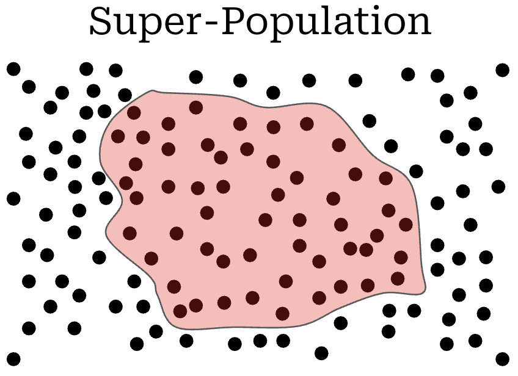

This framing allows us to rethink model evaluations. Instead of trying to measure a model's exact score on a specific fixed test set, we should view our evaluation score as an estimate of the model's true performance over the broader super-population of tasks.

Because our sample of $n$ questions is finite, our evaluation score has uncertainty. Our goal is to quantify this uncertainty using statistical error bars.

### Standard Errors and the CLT

The simplest evaluation setting occurs when each question $i$ is sampled independently from the super-population. For each question $i$, the model receives a score $s_i$. The overall evaluation score is the sample mean:

$$\bar{s} = \frac{1}{n} \sum_{i=1}^n s_i$$

Under the CLT, the standard error of this mean score is:

$$\widehat{\text{SE}}(\bar{s}) = \frac{s}{\sqrt{n}} = \sqrt{\frac{\sum_{i=1}^n (s_i - \bar{s})^2}{n(n - 1)}}$$

The corresponding 95% confidence interval is:

$$\text{CI}_{95\%} = \left[\bar{s} - 1.96 \cdot \widehat{\text{SE}}(\bar{s}), \; \bar{s} + 1.96 \cdot \widehat{\text{SE}}(\bar{s})\right]$$

#### The Binary Score Case

If the evaluation metric is binary (e.g., $s_i \in \{0, 1\}$ for exact-match accuracy), the standard error simplifies to:

$$\widehat{\text{SE}}(\bar{s}) = \sqrt{\frac{\bar{s}(1 - \bar{s})}{n - 1}}$$

This Bernoulli formula is easy to compute, but requires that scores are truly binary (i.e., not fractional like ROUGE or F1 scores).

In [1], Miller evaluates several leading models on standard benchmarks (GSM8K, MATH, HumanEval) and reports the resulting standard errors:

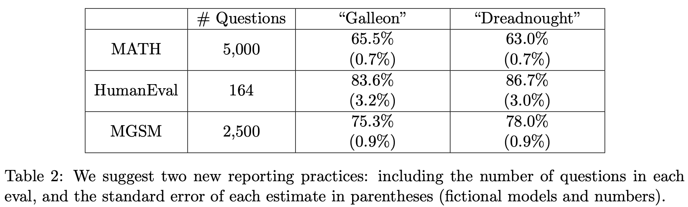

From these standard errors, we can compute 95% confidence intervals for each benchmark:

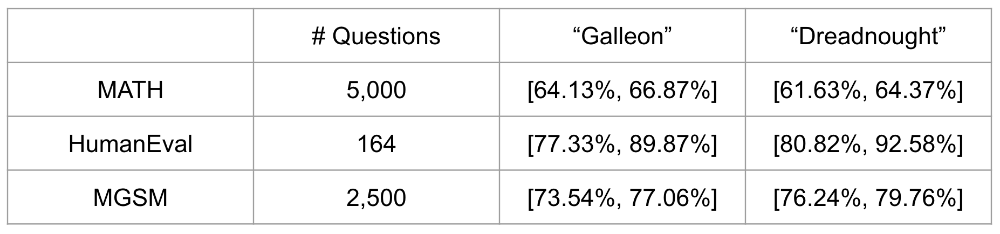

Notice how wide these confidence intervals are! On HumanEval ($n = 164$), the 95% confidence interval for Llama-3-70B spans roughly $\pm 6.9\%$. A model reported at 81.7% accuracy could easily have a true super-population accuracy anywhere between 74.8% and 88.6%. Reporting benchmark scores without error bars gives a false sense of precision.

---

### Clustered Errors

In many real-world benchmarks, questions are not independent. Instead, questions are organized into clusters:
* In MMLU, questions are grouped by academic subject.
* In multi-turn evals, multiple questions occur within the same conversation thread.
* In synthetic evals, multiple test cases are generated from the same template.

When questions within a cluster are correlated, the standard IID assumption is violated ($\text{Cov}(S_i, S_j) \neq 0$). If we ignore this correlation and use the standard CLT formula, our standard error will be artificially small, making our confidence intervals overly optimistic.

To account for this, Miller [1] recommends using a clustered standard error. Let $s_{i, c}$ denote the score for question $i$ in cluster $c$. The overall sample mean is still:

$$\bar{s} = \frac{1}{n} \sum_{c=1}^C \sum_{i \in c} s_{i, c}$$

The cluster-adjusted standard error is computed as:

$$\widehat{\text{SE}}_{\text{cluster}}(\bar{s}) = \sqrt{\frac{1}{n^2} \sum_{c=1}^C \left(\sum_{i \in c} (s_{i, c} - \bar{s})\right)^2}$$

We can expand this expression to see its relationship to the standard CLT error:

$$\widehat{\text{SE}}_{\text{cluster}}^2 = \widehat{\text{SE}}_{\text{CLT}}^2 + \frac{1}{n^2} \sum_{c=1}^C \sum_{i \in c} \sum_{j \in c, j \neq i} (s_{i, c} - \bar{s})(s_{j, c} - \bar{s})$$

> "The clustered standard error acts as a kind of sliding scale between cases where scores within a cluster are perfectly correlated (in which case each cluster acts as a single independent observation) and perfectly uncorrelated (in which case the clustered standard error is equivalent to the unclustered case). The intra-cluster correlations... are captured by the triple summation (over clusters and cross-terms within clusters)." - from [1]

When questions within the same cluster have positive correlation, the cross-terms are positive, and the clustered standard error is strictly larger than the naive CLT error.

---

### Reducing Variance

Once we can compute standard errors and confidence intervals, the natural next goal is to reduce evaluation variance so our benchmarks provide sharper conclusions.

To analyze where evaluation variance comes from, we apply the law of total variance. Consider:
* $S$: The score received on an evaluation query.
* $I$: The specific question sampled from the super-population.

Conditioning score $S$ on question $I$:

$$\text{Var}(S) = \mathbb{E}\left[\text{Var}(S \mid I)\right] + \text{Var}\left(\mathbb{E}[S \mid I]\right)$$

Let $X_I = \mathbb{E}[S \mid I]$ denote the expected score for question $I$, and let $\sigma_I^2 = \text{Var}(S \mid I)$ denote the within-question variance caused by stochastic generation. This gives:

$$\text{Var}(S) = \mathbb{E}[\sigma_I^2] + \text{Var}(X_I)$$

This decomposition reveals two distinct components of variance:
1. **Within-question variance** $\mathbb{E}[\sigma_I^2]$: Caused by random sampling during LLM decoding (temperature $> 0$) or judge stochasticity.
2. **Across-question variance** $\text{Var}(X_I)$: Caused by differences in intrinsic difficulty across questions in the dataset.

This leads directly to two actionable variance reduction strategies:

#### Strategy 1: Resampling Multiple Outputs ($K > 1$)

Instead of generating a single output per question, we can generate and score $K$ completions for each question $i$. Let $S_{i, k}$ be the score of the $k$-th sample on question $i$. The question-level mean score is:

$$\bar{S}_i = \frac{1}{K} \sum_{k=1}^K S_{i, k}$$

The variance of this averaged score is:

$$\text{Var}(\bar{S}) = \frac{\mathbb{E}[\sigma_I^2]}{K} + \text{Var}(X_I)$$

Resampling reduces the within-question variance linearly by a factor of $1/K$! However, it has zero effect on the across-question variance $\text{Var}(X_I)$. Once $K$ is large enough that $\mathbb{E}[\sigma_I^2] / K \ll \text{Var}(X_I)$, further increases in $K$ provide diminishing returns.

#### Strategy 2: Direct Token Probabilities

If an evaluation metric can be computed directly from the model's next-token logits (e.g., multiple choice benchmarks like MMLU), we can eliminate within-question variance entirely ($\sigma_I^2 = 0$).

For a multiple choice question with target option $y$, let $p_i = P(y \mid x_i)$ be the model's assigned probability. By taking $p_i$ as the score rather than sampling a greedy token, we obtain:

$$\text{Var}(S) = \text{Var}(X_I) = \text{Var}(p_I)$$

For multi-token responses $y_{1:T}$, the joint probability is:

$$P(Y = y_{1:T} \mid x) = \prod_{t=1}^T P(y_t \mid x, y_{<t})$$

> "We recommend a two-pronged variance-reduction strategy. When next-token probabilities are available, and the LLM eval can be conducted using next-token probabilities (i.e. without token generation), compute the expected score for each question, and compute the standard error of expected scores across questions. When next-token probabilities are not available, or the answer requires a chain of thought or other complex interaction, choose a $K$ such that $\mathbb{E}[\sigma_i^2] / K \ll \text{Var}(X)$ and compute the standard error across question-level mean scores. In neither case should the sampling temperature be adjusted for the sake of reducing variance in the scores." - from [1]

---

### Model Comparisons

When comparing two models, Model A and Model B, the standard industry practice is to report separate scores $\bar{s}_A$ and $\bar{s}_B$, and declare whichever is higher to be the winner. A statistically sound approach analyzes the difference between their scores.

#### Unpaired Comparisons

If Model A and Model B are evaluated on different sets of questions, the difference in their mean scores is:

$$\bar{d} = \bar{s}_A - \bar{s}_B$$

The variance of this difference is:

$$\text{Var}(\bar{s}_A - \bar{s}_B) = \text{Var}(\bar{s}_A) + \text{Var}(\bar{s}_B) - 2 \text{Cov}(\bar{s}_A, \bar{s}_B)$$

Because the models were evaluated on different questions, $\text{Cov}(\bar{s}_A, \bar{s}_B) = 0$. The unpaired standard error is:

$$\widehat{\text{SE}}_{\text{unpaired}}(\bar{d}) = \sqrt{\widehat{\text{SE}}^2(\bar{s}_A) + \widehat{\text{SE}}^2(\bar{s}_B)} = \sqrt{\frac{s_A^2}{n_A} + \frac{s_B^2}{n_B}}$$

The 95% confidence interval for the performance gap is:

$$\text{CI}_{95\%} = \left[(\bar{s}_A - \bar{s}_B) - 1.96 \cdot \widehat{\text{SE}}_{\text{unpaired}}, \; (\bar{s}_A - \bar{s}_B) + 1.96 \cdot \widehat{\text{SE}}_{\text{unpaired}}\right]$$

For Model A to be statistically significantly better than Model B at the 95% level, this interval must exclude zero (i.e., $\bar{s}_A - \bar{s}_B > 1.96 \cdot \widehat{\text{SE}}$).

#### Paired Comparisons: The Power of Positive Covariance

In practice, we almost always evaluate models on the exact same benchmark questions. This creates a paired evaluation setup.

Let $s_{A, i}$ and $s_{B, i}$ denote the scores of Model A and Model B on question $i$. We define the per-question score difference as:

$$d_i = s_{A, i} - s_{B, i}$$

The sample mean difference is:

$$\bar{d} = \frac{1}{n} \sum_{i=1}^n d_i = \bar{s}_A - \bar{s}_B$$

We can estimate the standard error directly from the variance of the differences:

$$\widehat{\text{SE}}_{\text{paired}}(\bar{d}) = \sqrt{\frac{s_d^2}{n}} = \sqrt{\frac{\sum_{i=1}^n (d_i - \bar{d})^2}{n(n - 1)}}$$

The relationship between the paired and unpaired standard error is governed by covariance:

$$\text{Var}(S_A - S_B) = \text{Var}(S_A) + \text{Var}(S_B) - 2 \text{Cov}(S_A, S_B)$$

Because different LLMs tend to agree on which questions are easy and which questions are hard, their scores across benchmark items are strongly positively correlated ($\text{Cov}(S_A, S_B) > 0$). This positive covariance subtracts from the overall variance!

As a result, the paired standard error is often dramatically smaller than the unpaired standard error:

$$\widehat{\text{SE}}_{\text{paired}}(\bar{d}) \ll \widehat{\text{SE}}_{\text{unpaired}}(\bar{d})$$

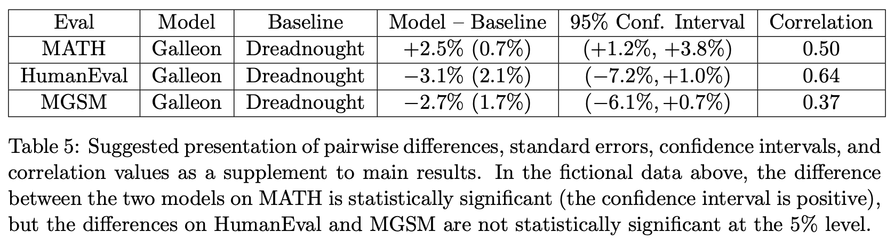

Looking at the table from [1], on GSM8K the individual confidence interval width for Llama-3-8B is $\pm 2.0\%$ and for Llama-3-70B is $\pm 1.4\%$. But the paired difference confidence interval width is only $\pm 1.4\%$. Evaluating models on the same test set neutralizes question-level difficulty variation, allowing subtle differences between models to become statistically detectable.

---

### Practical Implementation

Here is a complete, runnable Python implementation demonstrating how to compute standard errors, clustered standard errors, confidence intervals, and paired comparisons on model scores:

```python
import math
import numpy as np


#################################
# Evaluation settings and scores
#################################

# Model names
model_a_name = "Galleon"
model_b_name = "Dreadnought"

# Example scores for the models (n = 10)
model_a = np.array([1, 1, 0, 1, 0, 1, 1, 0, 1, 1], dtype=np.float64)
model_b = np.array([0, 1, 0, 0, 0, 1, 0, 0, 1, 0], dtype=np.float64)

# Cluster assignment: example with 2 clusters (even vs odd indices)
clusters = np.array([i % 2 for i in range(len(model_a))])

# Z-score for 95% confidence interval
z = 1.96
n = len(model_a)


#################################
# Single-model evaluation
#################################

print(f"=== Evaluating {model_a_name} ===")

# 1. Sample mean
s_bar_a = np.mean(model_a)
print(f"Mean Score: {s_bar_a:.3f}")

# 2. Naive CLT standard error
se_clt_a = np.std(model_a, ddof=1) / np.sqrt(n)
ci_clt_a = (s_bar_a - z * se_clt_a, s_bar_a + z * se_clt_a)
print(f"CLT Standard Error: {se_clt_a:.3f}")
print(f"CLT 95% Confidence Interval: [{ci_clt_a[0]:.3f}, {ci_clt_a[1]:.3f}]")

# 3. Bernoulli standard error (for binary metrics)
se_bern_a = np.sqrt((s_bar_a * (1 - s_bar_a)) / (n - 1))
ci_bern_a = (s_bar_a - z * se_bern_a, s_bar_a + z * se_bern_a)
print(f"Bernoulli Standard Error: {se_bern_a:.3f}")
print(f"Bernoulli 95% Confidence Interval: [{ci_bern_a[0]:.3f}, {ci_bern_a[1]:.3f}]")

# 4. Clustered standard error
se_cluster_a = np.sqrt(
    np.sum([np.sum(model_a[clusters == c] - s_bar_a)**2 for c in np.unique(clusters)])
    / (n**2)
)
ci_cluster_a = (s_bar_a - z * se_cluster_a, s_bar_a + z * se_cluster_a)
print(f"Clustered Standard Error: {se_cluster_a:.3f}")
print(f"Clustered 95% Confidence Interval: [{ci_cluster_a[0]:.3f}, {ci_cluster_a[1]:.3f}]")


#################################
# Model comparisons
#################################

print(f"\n=== Comparing {model_a_name} vs {model_b_name} ===")

s_bar_b = np.mean(model_b)
se_clt_b = np.std(model_b, ddof=1) / np.sqrt(n)
diff_mean = s_bar_a - s_bar_b

# 1. Unpaired comparison (assuming independent question sets)
se_unpaired = np.sqrt(se_clt_a**2 + se_clt_b**2)
ci_unpaired = (diff_mean - z * se_unpaired, diff_mean + z * se_unpaired)
print(f"Mean Difference (A - B): {diff_mean:.3f}")
print(f"Unpaired Standard Error: {se_unpaired:.3f}")
print(f"Unpaired 95% Confidence Interval: [{ci_unpaired[0]:.3f}, {ci_unpaired[1]:.3f}]")

# 2. Paired comparison (evaluated on identical questions)
diff_per_question = model_a - model_b
se_paired = np.std(diff_per_question, ddof=1) / np.sqrt(n)
ci_paired = (diff_mean - z * se_paired, diff_mean + z * se_paired)
print(f"Paired Standard Error: {se_paired:.3f}")
print(f"Paired 95% Confidence Interval: [{ci_paired[0]:.3f}, {ci_paired[1]:.3f}]")

# Check statistical significance
if ci_paired[0] > 0:
    print(f"Conclusion: {model_a_name} is statistically significantly better than {model_b_name} (p < 0.05).")
elif ci_paired[1] < 0:
    print(f"Conclusion: {model_b_name} is statistically significantly better than {model_a_name} (p < 0.05).")
else:
    print("Conclusion: No statistically significant difference detected.")
```

---

## More Topics to Explore in Statistics

Beyond computing standard errors and confidence intervals, several recent research papers have examined deeper statistical questions surrounding LLM evaluations.

### Power Analysis for LLM Evals [1]

When designing a new benchmark or deciding how many questions to run from an existing benchmark, we face a fundamental question: **How many evaluation questions do we actually need?**

Statistical power analysis answers this question. Power analysis is parameterized by:
* **Significance level ($\alpha$)**: The probability of a false positive (Type I error), typically $\alpha = 0.05$.
* **Statistical power ($1 - \beta$)**: The probability of correctly detecting a true performance difference when one exists, typically $1 - \beta = 0.80$ (meaning a false negative rate $\beta = 0.20$).
* **Minimum Detectable Effect ($\delta$)**: The smallest performance difference between models that we want to be able to reliably detect.
* **Score variance ($\sigma^2$)**: The variance of model scores across questions.

In [1], Miller derives a sample size formula for LLM evaluations:

$$n \ge \frac{(z_{1 - \alpha / 2} + z_{1 - \beta})^2 \cdot \sigma^2}{\delta^2}$$

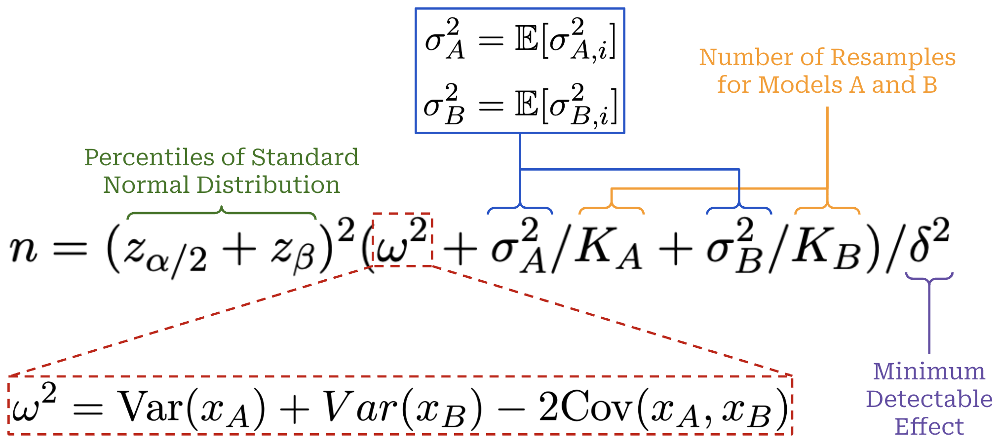

Here, $z_p$ denotes the $p$-th percentile of the standard normal distribution (for $\alpha = 0.05$, $z_{0.975} \approx 1.96$; for $\beta = 0.20$, $z_{0.80} \approx 0.84$).

This formula yields several critical insights:
1. **Inverse-square scaling with effect size**: The required number of test questions scales with $1 / \delta^2$. If you want to detect a 5% difference ($\delta = 0.05$) instead of a 10% difference ($\delta = 0.10$), you need **$4\times$ as many questions**. If you want to detect a 1% difference, you need **$100\times$ as many questions**.
2. **Linear scaling with variance**: Reducing score variance directly reduces the required sample size.

Here is a Python implementation to compute the required sample size and perform power analysis:

```python
import math
import numpy as np
from statistics import NormalDist


def required_sample_size(alpha: float, beta: float, delta: float, sigma_sq: float) -> int:
    """
    Compute the sample size required to detect an effect size delta
    with significance level alpha and power (1 - beta).
    """
    z_alpha = NormalDist().inv_cdf(1.0 - alpha / 2.0)
    z_beta = NormalDist().inv_cdf(1.0 - beta)
    n = ((z_alpha + z_beta)**2 * sigma_sq) / (delta**2)
    return math.ceil(n)


def decompose_variance(score_matrix: np.ndarray) -> tuple[float, float]:
    """
    Decompose total score variance into within-question and across-question variance.
    score_matrix has shape (n_questions, k_resamples).
    """
    n, k = score_matrix.shape
    if k < 2:
        raise ValueError("Need at least K >= 2 resamples to estimate within-question variance.")
    
    # Expected score per question
    x_i = np.mean(score_matrix, axis=1)
    
    # Within-question sample variance
    sigma_sq_i = np.var(score_matrix, axis=1, ddof=1)
    
    # Within-question variance: E[sigma_i^2]
    var_within = float(np.mean(sigma_sq_i))
    
    # Across-question variance: Var(X_i)
    # Using unbiased estimator: Var(x_i) - E[sigma_i^2] / K
    var_between = float(np.var(x_i, ddof=1) - var_within / k)
    var_between = max(0.0, var_between)
    
    return var_within, var_between


# Example settings
alpha = 0.05      # 5% false positive rate
beta = 0.20       # 80% power
delta = 0.05      # Minimum detectable difference: 5%

# Simulated scores: 100 questions, 3 resamples each
np.random.seed(42)
score_data = np.random.binomial(n=1, p=0.75, size=(100, 3)).astype(np.float64)

var_within, var_between = decompose_variance(score_data)
total_var_k1 = var_within + var_between

n_needed_k1 = required_sample_size(alpha, beta, delta, total_var_k1)
print(f"Variance decomposition: Within-Q = {var_within:.4f}, Across-Q = {var_between:.4f}")
print(f"Questions needed with K=1: {n_needed_k1}")

# If we resample K=5 times per question:
total_var_k5 = (var_within / 5.0) + var_between
n_needed_k5 = required_sample_size(alpha, beta, delta, total_var_k5)
print(f"Questions needed with K=5: {n_needed_k5}")
print(f"Sample size reduction from resampling: {100 * (1 - n_needed_k5 / n_needed_k1):.1f}%")
```

---

### Don't Use the CLT in LLM Evals With Fewer Than a Few Hundred Datapoints [2]

While the Central Limit Theorem is simple and powerful, it is an asymptotic result: it holds as $n \to \infty$. In a recent position paper, Bowyer et al. [2] investigate what happens when the CLT is applied to LLM evaluations in the small-data regime ($n \le 100$).

Their findings show that for small sample sizes, nominal 95% CLT confidence intervals often fail to provide 95% coverage in practice.

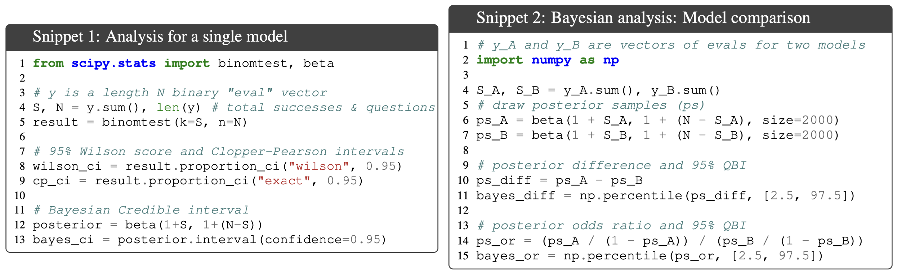

This problem is especially severe when:
* **Accuracy is close to 0% or 100%**: When $p$ is extreme, the Bernoulli distribution is highly skewed, and the normal approximation breaks down.
* **Sample size $n$ is small**: On benchmarks with small test splits ($n \le 100$), the empirical coverage of a nominal 95% CLT interval can drop as low as 80% or 75%.

> "It may be argued that CLT-based methods are usually sufficient in practice when their assumptions are satisfied. We do not disagree. However, we argue that it is safer to use the more robust strategies laid out in this paper, which are just as easy to apply, perform no worse for large $n$ and perform substantially better in the small-$n$ setting... knowing whether a certain $n$ is large enough for the CLT to hold would be extremely context-dependent and difficult to determine a priori." - from [2]

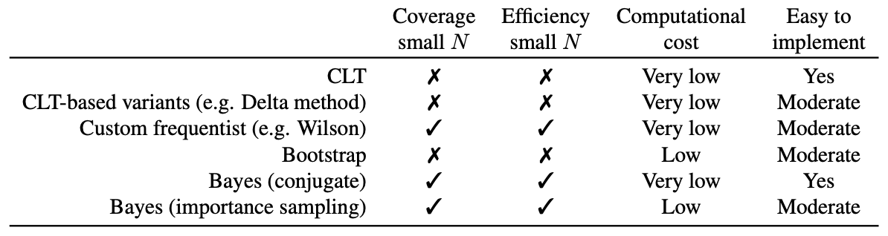

#### Robust Alternatives for Small $n$

When $n$ is small, Bowyer et al. recommend using alternative interval estimators that maintain correct coverage:
1. **Wilson Score Interval**: Adjusts the center and width of the interval based on the score test, avoiding catastrophic undercoverage near $p \in \{0, 1\}$.
2. **Agresti-Coull Interval**: A simple "add two successes and two failures" adjustment to the sample mean before computing standard errors.
3. **Beta-Binomial / Bayesian Credible Intervals**: Places a prior distribution over accuracy and computes exact posterior quantiles.

---

### Quantifying Variance in Evaluation Benchmarks [3]

In [3], Madaan et al. examine another major source of evaluation uncertainty: benchmark instability caused by trivial prompt perturbations and formatting variations.

Across standard benchmarks like MMLU, GSM8K, and ARC, they test how model performance varies when making minor, semantics-preserving modifications to evaluation prompts (e.g., changing few-shot demonstration examples, altering whitespace, or modifying instructions).

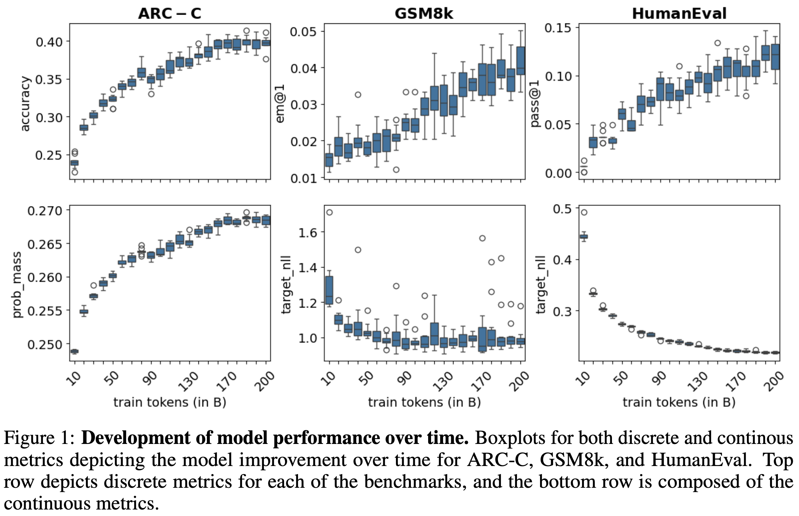

Their empirical findings reveal that:
* **Score fluctuations of 3% to 8% are common**: Simply changing the order of few-shot examples or the phrasing of instructions can swing a model's score by several percentage points.
* **Frequent ranking flips**: When comparing closely matched models, these prompt-induced fluctuations frequently invert the leaderboard rankings, producing spurious conclusions about which model is superior.

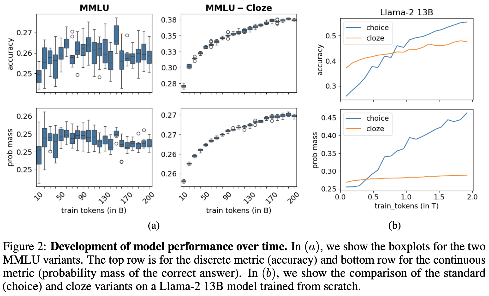

This work underscores that model performance is not a single deterministic scalar. Without accounting for prompt-level and sampling variance, benchmark leaderboards can easily measure noise rather than genuine capability advances.

---

### Signal and Noise: A Framework for Reducing Uncertainty [4]

In [4], Heineman et al. propose a unified framework for maximizing the signal-to-noise ratio in language model evaluations.

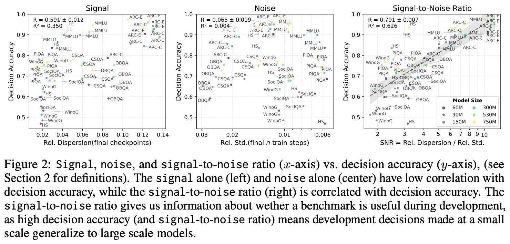

During model development, teams frequently run small-scale evaluations on intermediate checkpoints to guide decisions (e.g., hyperparameter tuning, data mixture selection, and learning rate schedules). If evaluation noise is large relative to the true performance improvement, developers risk optimizing for noise.

Heineman et al. propose three key interventions:
1. **Continuous Scoring via Token Probabilities**: Replacing discrete 0/1 accuracy with cross-entropy or target token log-probabilities increases the information content per evaluation example by up to $10\times$.
2. **Variance Reduction via Test-Time Compute**: Allocating additional test-time compute (resampling $K$ times and averaging) specifically on items with high within-question variance.
3. **Monotonicity as an Evaluation Metric**: Measuring whether evaluation scores increase monotonically across training checkpoints, rather than relying solely on the final checkpoint's raw score.

---

## Key Takeaways

Model evaluations are the steering wheel of LLM research. Navigating without statistical tools risks mistaking random fluctuation for algorithmic breakthrough.

To summarize the practical best practices:

* **Always report standard errors and confidence intervals**: A single number is incomplete. At minimum, compute the CLT standard error $\widehat{\text{SE}} = s / \sqrt{n}$ and report 95% confidence intervals $[\bar{s} \pm 1.96 \cdot \widehat{\text{SE}}]$.
* **Account for clustering**: If evaluation queries share common templates, subjects, or conversation contexts, use the cluster-adjusted standard error $\widehat{\text{SE}}_{\text{cluster}}$ to avoid overconfident error bars.
* **Use paired comparisons**: When comparing two models evaluated on the same test set, always compute the paired standard error on question-level score differences $d_i = s_{A, i} - s_{B, i}$. Positive covariance between models significantly tightens the confidence interval.
* **Be cautious with small $n$**: If $n \le 100$ or accuracy is near 0% or 100%, the CLT normal approximation breaks down. Use robust alternatives like Wilson score or Agresti-Coull intervals.
* **Apply variance reduction**: Decompose variance using the law of total variance. Use direct token probabilities when available, or resample $K > 1$ completions to shrink within-question variance.
* **Run power analysis before commissioning new benchmarks**: Use sample size formulas to ensure the test set is large enough to detect the expected effect size.

---

## Bibliography

[1] Miller, Evan. "Adding error bars to evals: A statistical approach to language model evaluations." arXiv preprint arXiv:2411.00640 (2024).

[2] Bowyer, Sam, Laurence Aitchison, and Desi R. Ivanova. "Position: Don't Use the CLT in LLM Evals With Fewer Than a Few Hundred Datapoints." arXiv preprint arXiv:2503.01747 (2025).

[3] Madaan, Lovish, et al. "Quantifying variance in evaluation benchmarks." arXiv preprint arXiv:2406.10229 (2024).

[4] Heineman, David, et al. "Signal and noise: A framework for reducing uncertainty in language model evaluation." arXiv preprint arXiv:2409.00630 (2024).

---

### Footnotes

1. The evaluation process is stochastic, so if we re-run the evaluation on this question multiple times we can observe a different result.
2. Previously, we introduced the sample variance, denoted as $s^2$. The sample standard deviation, denoted as $s$, is simply the square root of this expression.
3. The $z$-score refers to the realized value $z$ of the standardized random variable $Z$.
4. The reason we must assume variance $\sigma^2$ is finite is so that this expression is well-defined and exists. Standard deviation and standard error are not finite or meaningful when variance is infinite.
5. We write the normal distribution as $\mathcal{N}(\mu, \sigma^2)$, where $\mu$ is the mean of the normal distribution and $\sigma^2$ is the variance.
6. Here, the unconditional versions of $s$ and $x$ (without the $i$ subscript) are used, so we are taking this expectation over the entire super-population.
7. More specifically, if we are reporting a metric in the range $[0, 1]$ that takes fractional values (e.g., an F1 score or ROUGE), this Bernoulli formula cannot be used.
8. Practically, monotonicity is computed by taking the sequence of scores throughout training and measuring the Kendall rank correlation between this sequence and a perfectly monotonic sequence (i.e., a sequence in which performance strictly increases at every training checkpoint).
9. In the context of LLMs, a Cloze task refers to a fill-in-the-blank test where the model is given context with missing tokens and asked to predict the missing information.
