This is a topic that has fascinated me for ages and i finally have showcase-worthy results. Everything here, including each test as it was written before it ran, is public at [nematica.weptune.dev](https://nematica.weptune.dev), on [X](https://x.com/W3ptune/status/2124172793025827293), and in the [repository](https://github.com/Weptune/nematica).

Ask what separates a brain from an artificial neural network and the usual answer is a list of parts, but none of them says whether it matters for what the system does, because a difference in parts only becomes a difference in kind once it shows up in something that can be measured on both systems.

NEMATICA is my attempt to measure it. The method fits in three sentences. Record a living nervous system and an artificial network the same way, through the same instrument. Run both through the same tests. Score every test against one yardstick, how much real animals differ from each other, so that a network passes when it sits no further from an animal than a second animal would.

The animals are a worm with 302 neurons and the visual cortex of the mouse. The artificial systems run from linear models fitted to recordings up to transformers with a billion parameters. This post goes through the seven questions I asked, what came out of each, and what I think they add up to.

The short version: in six of the seven, an ordinary network or an ordinary copy of a brain was measurably unlike the animal. In five of those, the difference traced back to something specific that the network had not been shown or had not been built to carry, and supplying it closed the gap or most of it. The sixth is still unexplained. In the seventh I predicted a difference and found none.

---

## 1. The Animals and the Networks

### Why a Worm

_Caenorhabditis elegans_ is a nematode one millimetre long with 302 neurons. Its wiring diagram was the first to be mapped completely (White et al., 1986), and a modern microscope can record a large share of the neurons in its head at once, many of them identified by name.

For a project about cause and effect, the decisive dataset is the signal propagation atlas of Randi et al. (2023). In 113 worms held still under the microscope, single neurons were switched on with light, one at a time, about every 30 seconds, while the rest of the head was imaged. That gives a brain's ongoing activity and its response to being pushed at a known place, in the same animals.

### Why a Mouse

A result in one animal is a result about that animal. The second species is the mouse, through the Allen Institute's Neuropixels recordings: probes that pick up spikes from single cells across visual cortex and the regions beneath it, released with standardised processing. One of those datasets includes sessions in which two kinds of inhibitory cell, Sst and Vip, were made sensitive to light and driven during the recording. That is the mouse counterpart of poking a worm's neuron.

### The Data

| Recordings                                    | Animals   | What they are                                                                                                                     | Used in           |
| :-------------------------------------------- | :-------- | :-------------------------------------------------------------------------------------------------------------------------------- | :---------------- |
| Signal propagation atlas (Randi et al., 2023) | 113 worms | Held still; one neuron switched on by light about every 30 s; the head imaged at 2 frames per second for about 37 minutes         | I, VI             |
| Atanas et al. (2023)                          | 30 worms  | Moving freely, whole-brain imaging                                                                                                | VII (development) |
| Baskoylu et al. (2026)                        | 27 worms  | Moving freely in an arena with a copper barrier                                                                                   | III, VII (test)   |
| Allen Visual Coding Neuropixels               | 58 mice   | Spikes from visual cortex, at rest and watching repeated film clips                                                               | IV, V             |
| Allen Visual Behavior Neuropixels             | 66 mice   | Spikes across cortex while light is delivered: 39 mice whose Sst or Vip cells respond to it, and 27 with no light-sensitive cells | II, VI            |

None of these recordings are mine. They were made and published by the people named above, and the project keeps only summary numbers computed from them.

### The Artificial Side

The artificial systems appear in two roles.

A **copy** is a model fitted to recordings of an animal and then asked to stand in for it: simulate a worm it has not seen, or predict what a mouse's cortex does when some of its cells are driven. The copies here are linear autoregressive models with 0.5 to 5 seconds of memory, the published worm models of Creamer et al. (2024), and models I built by adding ingredients to the linear ones.

A **network as it comes** is never fitted to an animal. It is run, recorded through the animal's instrument, and measured: a random recurrent network, a recurrent network trained on a task, a spiking network, GRU and CfC character models, Pythia transformers from 14 million to 1 billion parameters, and Mamba state-space models at 130 and 370 million.

The first role asks whether a model of a brain is a model of _that_ brain. The second asks whether networks nobody tried to make brain-like differ from brains anyway. The seven questions use both.

|     | Question                                                                         | Role of the network | Animals           |
| :-- | :------------------------------------------------------------------------------- | :------------------ | :---------------- |
| I   | **The Echo.** Poke one neuron: does a copy respond the way the real brain does?  | copy                | 113 worms         |
| II  | **The Push.** Can watching tell which way a cell pushes the rest of the brain?   | copy                | 39 mice           |
| III | **The Face.** Is a good copy still an individual, or an average animal?          | copy                | 27 worms          |
| IV  | **The Long Memory.** Does a brain hold on to the past longer than a network?     | as it comes         | 35 mice           |
| V   | **The Inner Light.** Does a brain carry more internal state than a network?      | as it comes         | 49 mice           |
| VI  | **The Waning.** Ask the same thing twice: does the answer fade?                  | as it comes         | 37 worms, 39 mice |
| VII | **The Journey.** Does a copy built on a still animal hold once the animal moves? | copy                | 57 worms          |

The names come from the project site, where each question is filed under one of the seven classical planets. They are labels and nothing more.

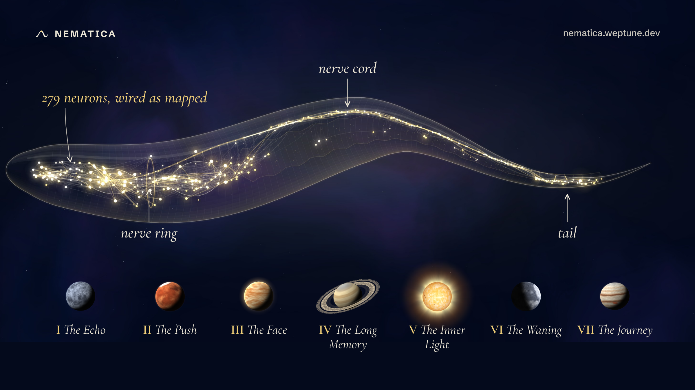
_Figure 1: The worm's nervous system as the project site draws it, with the seven questions beneath._

---

## 2. A Yardstick Made of Animals

The two usual ways to judge a model of a brain are forecasting (how well does it predict the next moment of recorded activity) and plausibility (does its activity look right). Both leave out a basic fact: real animals differ from each other. Two worms with the same genome and nearly the same wiring produce measurably different recordings. Any tolerance for calling a model close enough has to come from somewhere, and that spread is the only source that is not arbitrary.

So every test here has the same form. Take a property of a recording, for example which neurons rise and fall together, and a distance $d$ between two recordings on that property. Compute the distance between pairs of real animals the copy never saw, and between each of the copy's simulated animals and each real one. Then compare the medians:

$$E = \frac{\operatorname{med}\, d(\text{copy}, \text{animal}) \;-\; \operatorname{med}\, d(\text{animal}, \text{animal}')}{\operatorname{med}\, d(\text{animal}, \text{animal}')}$$

At $E = 0$ the copy is as far from real animals as they are from each other. At $E = 0.5$ it is 50% further. A negative value means it is closer to them than they are to each other. Pairwise distances share animals, so the interval on $E$ comes from resampling whole animals, not pairs. That gives three verdicts:

- **Inside**: the interval includes zero. On this property the copy cannot be told from another animal.
- **Outside**: the whole interval lies above zero. The copy is further away than another animal would be.
- **Too typical**: the whole interval lies below zero. The copy is closer to every real animal than real animals are to each other.

The third verdict is the one most scoring schemes lack. A model fitted to minimise its average error over many animals is pulled toward the population mean, and the mean is closer to every individual than individuals are to one another. A scheme that only asks whether the error is small rewards that. Question III is about exactly this.

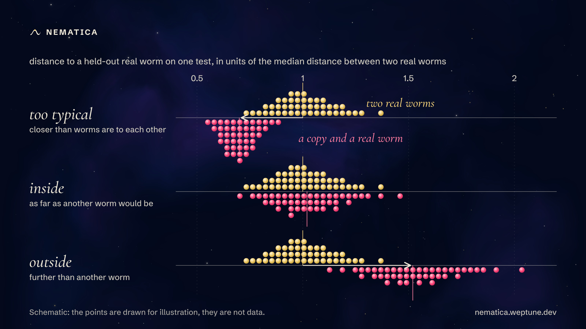
_Figure 2: The three verdicts, as a schematic (the points are drawn for illustration and are not data). Gold: distances between pairs of real worms on one test. Pink: distances between a copy's simulated worms and real worms. The verdict follows from the shift between the two medians and from whether its interval, found by resampling worms, excludes zero._

For the mouse questions, where the systems are networks and not copies, the same idea takes a simpler form: the unit is the standard deviation of a measurement across mice, and a network's distance from a mouse is reported in those units.

### How Fine the Yardstick Is

A yardstick has a resolution, and I measured this one by damaging real worms on purpose. Known errors were written into held-out worms' own responses to stimulation, and the damaged worms were scored as if they were copies. Attributing a poke to the wrong neuron in half the trials, or making every response 1.5 times too large, was caught in 6 of 6 groups of held-out worms. Errors of about a quarter often passed.

So "inside" in what follows means within roughly 25% of a real worm on that test. It does not mean identical.

### Rules of Procedure

A project like this has many places to fool itself, so three rules held throughout.

1. **Every test is written down before it runs.** The measure, the data, the decision rule and the claims are frozen in a dated document. Later changes are dated amendments that say whether they came before or after any data was seen. A registered test runs once.
2. **Methods are tried first where the answer is known.** Each measure is run on synthetic systems built to have or to lack the property. If it cannot tell them apart, the test stops there. Several planned tests ended at that step, before any real data was read.
3. **Results that went against me are reported as they came out.** Question V is one. Where a result below was not registered in advance, the section says so.

Each registered study was also checked, before it was frozen and again after its result, by separate AI agents: instances of Claude that had not written the code and were told to look for reasons the result was wrong or overstated. That is not peer review and I do not want to pass it off as peer review. It did change several of the readings below, and the corrections sit in the public record next to the results.

---

## 3. One Instrument for Both

A recording is not the system. Calcium imaging in the worm sees the neurons that could be tracked and named in that animal (in the atlas a median of 123 tracked and 72 named, out of 302), at two frames per second, through an indicator that blurs fast changes, with noise. A set of Neuropixels probes yields spike times from a sample of cells, with only a few spikes per cell in any short window. A simulated network hands over every unit at every step with no noise at all. Compare the two directly and the result is mostly a comparison of instruments.

So every network is recorded through a model of the animal's instrument before anything is measured: the same number of units, the same sampling rate, the same noise, the same gaps. A copy of a worm answers with one row per neuron that was tracked in the real worm it stands in for, with holes where that worm's tracking had holes. A network compared with a mouse is turned into spikes by a simulated instrument set to that mouse's own numbers.

How much this matters was one of the first quantitative results. I took one random recurrent network, recorded it through the instruments of five different mice, and measured the same property each time. The value moved by 1.8 times the standard deviation between mice. The choice of instrument shifted a network further than real animals differ from one another.

Before I understood that, matching every network to a single typical instrument produced patterns that were wrong in both directions, and several registered tests had to be declared not testable. The design that works is paired: record each network through each animal's own instrument, and compare it with that animal.

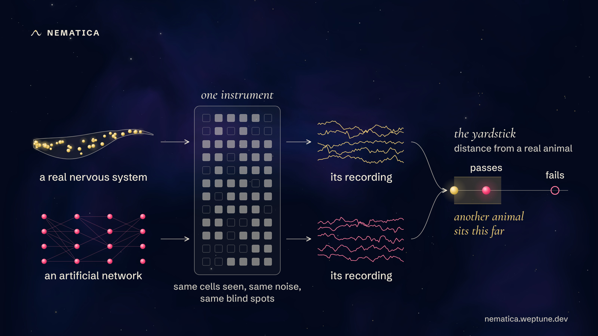
_Figure 3: The comparison in outline. A real nervous system and an artificial network pass through one instrument, and the two recordings are compared on a yardstick whose unit is the distance to another real animal._

---

## 4. The Echo: Poke One Neuron

**Question I.** Switch on one neuron. Does a copy of the brain respond the way the real brain does?

Each copy is fitted on about two thirds of the 113 atlas worms and then simulates the remaining third, worm by worm, with that worm's own neurons and its own schedule of pokes. The poked neuron's measured activity is handed to the copy, so the test is about what the rest of the brain does, not about how a neuron answers light.

For a poke of neuron class $i$ at time $t_0$, the response of class $j$ is its mean change over the next 15 seconds relative to the 5 seconds before, in units of its own fluctuations $\sigma_j$, averaged over pokes:

$$r_{ij} = \left\langle \frac{F_j(t) - \bar{F}_j^{\,\text{pre}}}{\sigma_j} \right\rangle_{t_0 \,\le\, t \,\le\, t_0 + 15\,\text{s}}$$

The matrix $r$ is the worm's **echo pattern**: which classes answer a poke of which, and with what sign. Agreement between two worms, or between a copy and a worm, is the correlation of their patterns over the pairs that both have:

$$a = \operatorname{corr}_{(i,j)}\!\left(r^{A}_{ij},\; r^{B}_{ij}\right)$$

Two real worms agree at about $a = 0.10$ (0.087 to 0.121 across groups of held-out worms). That is low in absolute terms, because each worm contributes only a few pokes per pair of neurons and each response is noisy. It is also the reason for the yardstick. 0.10 is the score of a second real worm, so it is the score a copy should reach, and a copy that scored 0.5 would be too typical.

### Two Kinds of Copy

**Copies that only watched.** These are linear autoregressive models fitted to recorded activity alone (the stimulation-free frames, the stimulated frames, or all of them), without being told when or where the light fell. They have between 0.5 and 5 seconds of memory, with rectified and sparse variants: 45 scores in all. They pass between 1 and 5 of six tests of resting activity (the distribution of activity values, timescales, which neurons move together, dimensionality, lead and lag, and how long reversal bouts last). Their echo agreement runs from $-0.01$ to 0.02. Every one of them is outside.

**Copies that also learned from pokes.** These keep a model of ongoing activity and add, from the training worms' pokes, a learned response of each neuron class to a poke of each other class. On worms they have never seen they score 0.08 to 0.12, and the yardstick puts 17 of their 19 scores inside.

Two controls show what carries the result. The same model with its learned links scrambled scores 0.00 to 0.01. With links taken from the anatomical wiring diagram in place of the pokes, it scores 0.01 to 0.02. In this model at least, knowing the wiring is not a substitute for having seen the brain respond. The best model I did not build, the fully connected model of Creamer et al., reaches 0.06 to 0.08, still outside.

Across all 88 scores (30 models, each in up to three groups of held-out worms), the rank correlation between how well a model matches resting activity and how well it matches the echo is $-0.06$. How good a copy looks at rest says nothing about whether it responds correctly.

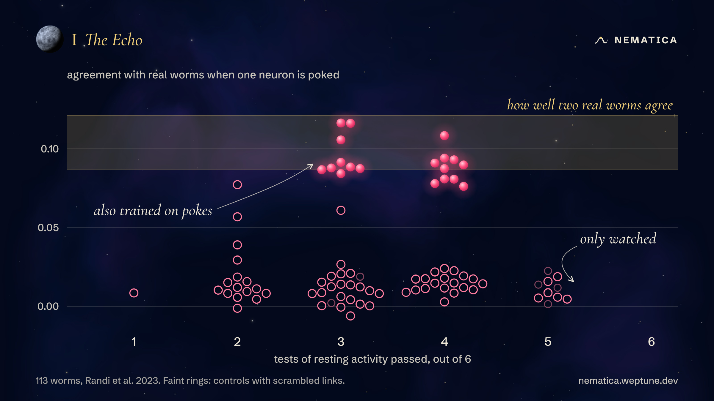
_Figure 4: Each mark is one model in one group of held-out worms. Across: how many of the six tests of resting activity it passes. Up: how well its echo pattern agrees with real worms. Open rings are models with no links learned from pokes, filled marks are models that also learned from pokes, and faint rings are the controls with scrambled or wiring-diagram links. The gold band is how well two real worms agree with each other; it is the target for a copy, not a container for the marks._

### Why Watching Is Not Enough

The reason is not specific to worms. Suppose activity follows $x_{t+1} = A x_t + \varepsilon_t$ and only some neurons are recorded. Fitting a model to the recorded part gives, in effect,

$$\hat{A} = C_1\, C_0^{-1}, \qquad C_k = \operatorname{cov}\!\left(x^{\text{obs}}_{t+k},\; x^{\text{obs}}_{t}\right)$$

and $\hat{A}_{ij}$ is large whenever $j$ predicts $i$. That happens when $j$ drives $i$. It happens just as well when both are driven by a neuron the microscope did not see, or by a slow state shared across the brain. Resting data cannot separate these cases, and with a quarter of the neurons named in a typical worm, a great deal is unseen. A poke separates them at once: it sets $x_j$ from outside, so whatever follows in $i$ was caused by $j$.

In the worm the problem looks worse than a shortage of data. The strongest watcher I could build predicted poke responses at about zero even though a check on the amount of data passed. That points at influence which resting activity does not express at all, such as connections that stay quiet until driven hard. By the rule I had registered, that reading is only partly supported, so I hold it loosely.

### One Model That Passes Both Halves

At this stage no single model passed at rest and when poked. The best watchers passed five resting tests and failed the echo; the poke-trained models passed the echo with three or four resting tests. Building one model that passes both became a way of listing what such a model needs.

The version that passes the registered rule (at least five of the six resting tests, plus the pattern, size and spread of the echo) in 5 of 5 noise seeds, on both splits of the 113 worms, has four things beyond a plain linear model. Removing them one at a time shows what each is for:

- **Responses learned from pokes.** Without them the echo pattern fails in every group.
- **Slow states shared across the brain.** Without them correlations come out too typical and the size of the echo fails.
- **Individuality.** Each simulated worm borrows the slow structure of one real worm. Without that, timescales and correlations are too typical.
- **A neuron-by-neuron readout.** Reading the model out per class of neuron, as earlier versions did, inflated its echoes. This one is the instrument again, not biology.

One thing it did not need was fast coupling between different neuron types. Removing that improved its resting score. The detail comes back in Question VII.

The caveats are real. The model was designed on these worms, so its passes show robustness across splits and seeds, not confirmation in new animals. On a separate set of worms carrying the _unc-31_ mutation it passed in 3 of 5 seeds, where the bar I had set was 4. And a pass means within about a quarter of a real worm.

---

## 5. The Push: Which Way Does a Cell Push?

**Question II.** In mouse cortex, can a copy built by watching tell which way a group of cells pushes the rest of the brain?

The Echo is a result about a worm, a calcium microscope and single neurons. The Push asks the same thing with nothing in common except the logic: mouse cortex, spikes, and whole populations of a genetically defined cell type.

In the Allen Visual Behavior Neuropixels sessions, mice carried a light-gated channel in one of two kinds of inhibitory interneuron, Sst or Vip. Each session has about five minutes of spontaneous activity and a block in which light is delivered either as 10 ms pulses or as a slower swell lasting one second. I registered five claims before computing any response to the one-second light. Then I built a linear copy from the spontaneous minutes alone and asked it one coarse question: when these cells are driven, what share of brain regions goes up? (A region here is a group of units from one brain area with one spike shape.)

|                                                             | Sst mice (29) | Vip mice (10) |
| :---------------------------------------------------------- | :------------ | :------------ |
| Share of regions that rose, measured (median)               | 12.5%         | 79%           |
| Share the copy fitted to rest predicted would rise (median) | 77%           | 69%           |
| Mice in which most regions fell (Sst) or rose (Vip)         | 29 of 29      | 10 of 10      |

Driving Sst cells lowered activity in most regions in every one of 29 mice. The copy built from rest predicted the opposite, a rise in 77% of regions, and in 28 of the 29 mice it predicted more regions rising than actually rose.

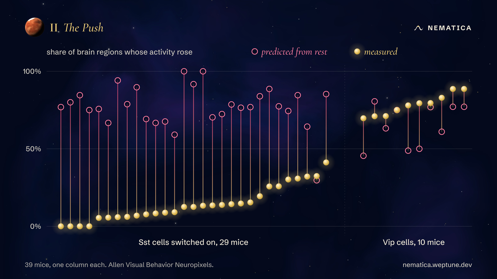
_Figure 5: One column per mouse. Gold: the share of brain regions whose activity rose when the tagged cells were driven. Pink ring: the share that a copy fitted to resting activity predicted would rise. Left, 29 mice with light-sensitive Sst cells, ordered by the measured share. Right, 10 mice with light-sensitive Vip cells._

### Why the Copy Gets the Sign Wrong

The explanation turned out to be simpler and more general than a failure about Sst cells, and I owe it to the review that followed the result.

At rest, both cell types drift up and down very slightly with the rest of cortex: a correlation of about 0.04, positive in 28 of the 29 Sst mice. A linear copy turns "moves with" into "drives". Its predicted sign does not even depend on the time course of the light. It is the sign of the resting gain from the tagged cells. Hand it a random group of ordinary visual cortex units as if they were the driven cells, and it predicts a rise in 60% to 80% of regions too.

So resting co-activity carries no information about the sign of a cell's effect. What an Sst cell does to its targets, and what a Vip cell does to its targets (mostly other inhibitory cells), lives in the connections, and watching does not reveal it.

One control I should have registered and did not: in 27 mice with no light-gated channel, the light alone raised activity in a median 66% of regions, presumably because the mice see it or otherwise react to it. Against that baseline the Sst fall is large and the Vip rise is small. The Sst result is the solid one.

### What Closes It

Each session also contains the 10 ms pulses. A copy taught by a mouse's own response to those pulses, then asked about the slow one-second drive, predicts that 31% of regions rise (12.5% did) and is on the correct side in 27 of 29 mice. Its pattern across regions agrees with the measured one at 0.60, where a second mouse's own response agrees at 0.36. By the registered rule that copy answers like a second mouse, and the watching copy does not.

The review again cut the claim down to size. With this light protocol the fitted copy is exactly a time-weighted version of each region's raw pulse response, and the raw response scores 0.63 with no fitting at all. A copy that never saw this mouse's stimulation, only other mice's pulses, scores 0.51.

So the finding is not that I built a good model. It is that a small amount of stimulation data supplies what no amount of watching did, and that almost no modelling is needed to use it.

---

## 6. The Face: An Individual or an Average?

**Question III.** Is a copy that forecasts well a copy of an individual, or of the average animal?

This is the "too typical" verdict turned into an experiment. The data are 27 freely moving worms (Baskoylu et al., 2026). Each worm $i$ gets its own linear model of its neural activity, pulled toward a model shared by all worms with a strength $\lambda$:

$$W_i = \arg\min_{W}\; \lVert Y_i - X_i W \rVert^2 \;+\; \lambda\, \lVert W - W_{\text{pool}} \rVert^2$$

At small $\lambda$ every worm keeps its own dynamics. At large $\lambda$ every worm is the pooled model. Two numbers are read off at each setting:

- **Forecast skill** is the usual one. Fit on the first half of a worm's recording, predict the second half, report $R^2$.
- **Individuality** is the yardstick's. It is the median distance between the copy's simulated worms divided by the median distance between real worms. At 1 the simulated worms differ from each other as much as real ones do.

| $\lambda$      | 30    | 100   | 300       | 1,000 | 3,000     | 10,000 | 100,000 |
| :------------- | :---- | :---- | :-------- | :---- | :-------- | :----- | :------ |
| Forecast $R^2$ | 0.701 | 0.733 | 0.752     | 0.760 | **0.761** | 0.760  | 0.758   |
| Individuality  | 1.052 | 1.038 | **0.990** | 0.909 | 0.783     | 0.625  | 0.456   |

Forecast skill peaks at $\lambda = 3{,}000$. At that setting individuality is 0.78, and the simulated worms are too typical on which neurons move together and on how neurons encode velocity and reversals. Back off to $\lambda = 300$ and the forecast is worse by 0.009 in $R^2$, while individuality returns to 0.99.

Forecast error is the standard way to select a model of neural data. Selected that way, the model drifts toward the average animal, and the forecast metric barely registers what was lost. Being a particular animal is a different property from predicting the next frame, and it has to be scored separately.

Two side results sharpen this. Across model families that forecast within 0.006 in $R^2$ of each other, individuality ranged from 0.33 to 1.37, so forecast skill does not rank realism either. And what has to differ between simulated worms is the dynamics: giving each worm only its own noise closed about 15% of the gap to real worms, while giving each its own dynamics closed 55% to 77%.

This question was not registered in advance. The idea came after the first results, and I checked it by choosing $\lambda$ on two groups of worms and scoring the third, which gave 7 of 8 tests inside on every held-out group. It is also one lab's worms.

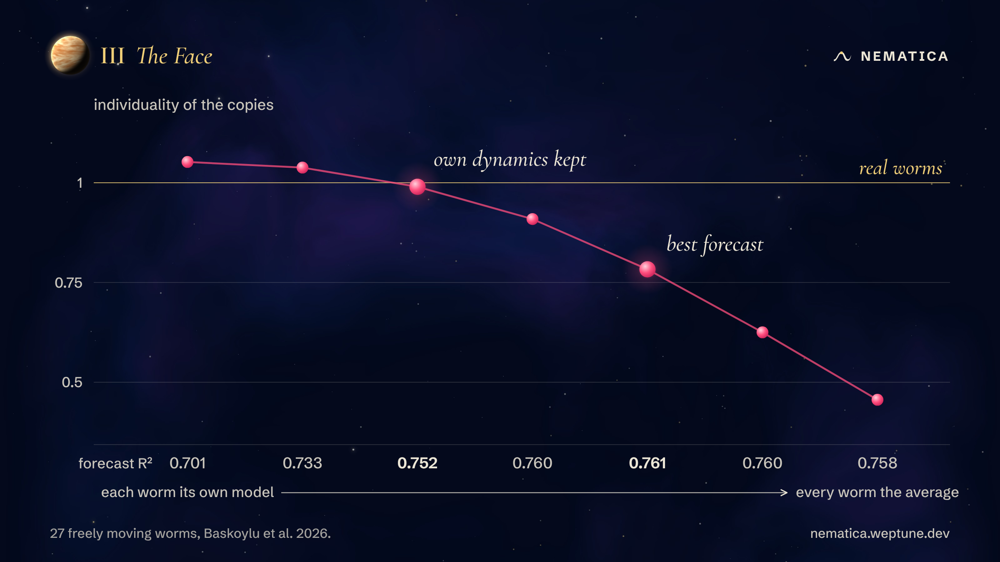
_Figure 6: Individuality of the simulated worms (1 = as different from each other as real worms are) as each worm's model is pulled from its own dynamics, on the left, toward the average of all worms, on the right. The row beneath gives the forecast skill at each setting. The best forecaster is the fifth point. The third keeps each worm's own dynamics at a cost of 0.009._

---

## 7. The Long Memory: Holding On to the Past

**Question IV.** Does a brain hold on to the past longer than a network does?

From here on the artificial systems are no longer copies. They are networks as they come, recorded through each mouse's instrument.

The measure is called slow memory. Let $\rho_i(\tau)$ be the autocorrelation of unit $i$ at lag $\tau$, corrected for measurement noise, and let $\tau_{\text{med}}$ be the median time over which a unit's activity forgets itself. Then

$$S = \operatorname{med}_i\; \rho_i\!\left(10\,\tau_{\text{med}}\right)$$

A system with a single timescale has forgotten nearly everything after ten of its own time constants, so $S$ is close to zero. $S$ rises when part of the activity is much slower than the typical unit. The lag is counted in units of the system's own typical timescale, so the question is about the mixture of timescales and not about raw speed.

In 35 mice during spontaneous activity, $S$ runs from 0.03 to 0.23. A random recurrent network of 480 units, recorded through each mouse's own instrument, has less slow memory than the mouse in 33 of 35, by a median of 1.4 standard deviations between mice (90% interval 1.24 to 1.59). The same network with strong slow drives added has more than all 31 mice it could be compared with, by 3.3. Cortex sits between the two.

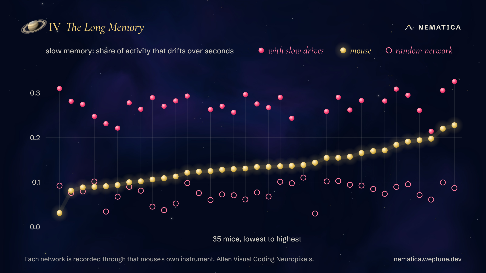
_Figure 7: Slow memory in 35 mice (gold, ordered from lowest to highest). In each mouse's column, the random network (open ring) and the same network with strong slow drives (pink), both recorded through that mouse's own instrument._

The next step was to tune the dial. On 17 mice I looked for the strength of slow drive that matched, and it is small: a slow input carrying about 6% of each unit's variance. On 18 mice held out from that tuning, the network with the drive sits 0.03 standard deviations from the mice at the median.

The registered rule asked for more than a centred median, though. The 90% interval runs from 0.08 on one side to 0.73 on the other, which is too wide to call equivalence. What I can say is that a small slow drive puts the network on the typical mouse. I have not shown the two are interchangeable, and the network does not reproduce how mice differ from one another.

The limits: this is one family of network and one measurement. The comparison rule was registered after the mouse values were known, though before any network had been recorded. Most other network families are too fast to be compared on this measure.

---

## 8. The Inner Light: The Prediction That Failed

**Question V.** Does a brain carry more internal state than a network?

By this point I had a thesis. The worm copy needed slow shared states. Watching failed because of influence that resting activity does not show. The random network had too little slow memory. It all pointed one way: brains carry more, and slower, internal state than artificial networks, where internal means activity that is not set by the current input. I registered that as four claims and designed a study to test it across the standard families of network.

The measure needs no model. Show every system the same 30-second film clip many times. Whatever repeats from one showing to the next is driven by the film, and whatever differs between showings is internal. With $Y_r(t)$ the activity of a unit on repeat $r$:

$$C_{\text{same}}(k) = \Big\langle \operatorname{cov}\big(Y_r(t),\, Y_r(t+k)\big) \Big\rangle_{r}, \qquad C_{\text{cross}}(k) = \Big\langle \operatorname{cov}\big(Y_r(t),\, Y_{r'}(t+k)\big) \Big\rangle_{r \neq r'}$$

$$M_1 = \frac{C_{\text{same}}(k_0) - C_{\text{cross}}(k_0)}{C_{\text{same}}(k_0)}$$

$M_1$ is the **internal share**: the fraction of a unit's structured activity that is not locked to the film. It is taken at a lag of two time bins ($k_0 = 2$, or 40 ms) because the first two lags are dominated by the statistics of single spikes. A network with no noise of its own can only hold internal state that it carries in from before the clip, so each repeat is preceded by a different context. For the networks that read text, the clip is about 20 tokens or characters.

Across 49 mice watching the film, the median internal share is 0.59, with the middle half of the mice between 0.54 and 0.67.

| Network                        | Internal share $M_1$   | Registered verdict on "the mice have more" |
| :----------------------------- | :--------------------- | :----------------------------------------- |
| GRU                            | 0.13                   | confirmed                                  |
| CfC                            | 0.16                   | confirmed                                  |
| Pythia, 14M to 1B              | 0.33, 0.51, 0.46, 0.60 | not decided: the sizes straddle the mice   |
| Task-trained recurrent network | 0.80                   | refuted: the network has more              |
| Mamba, 130M and 370M           | 0.85, 0.86             | refuted: the network has more              |
| **Mice (median of 49)**        | **0.59**               |                                            |

All four claims failed.

1. **Cortex carries more internal state.** Two families carry far less than the mice, two carry more, and the Pythia sizes straddle the typical mouse.
2. **Its internal state is slower relative to the input.** No family that counted confirmed this, and the GRU went the other way.
3. **A slow drive closes the gap and simpler controls do not.** The best slow drive overshot the mice.
4. **Scale is not what closes it.** Pythia at 1 billion parameters sits closer to the mice than Pythia at 14 million, by about two between-mouse spreads.

Measured this way, mouse visual cortex watching a film is not at the end of any scale. It sits in the middle of a range that ordinary artificial networks already span.

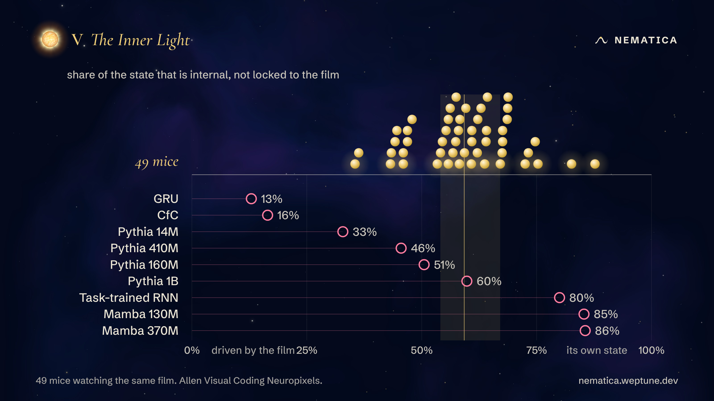
_Figure 8: The internal share in 49 mice (gold, one dot per mouse; the shaded band is the middle half of them) and in nine artificial networks, each on its own row. The networks land on both sides of the mice._

Two things keep this from being the last word. First, the measure only sees internal state within a 30-second repeat. Drift over minutes, which was part of the original thesis and is what Question IV picked up, is not tested here.

Second, one pattern stood out after the result. Along the clip, the mice hold their internal share (0.58 in the first half, 0.66 in the second) while most networks lose theirs: the GRU goes from 0.21 to 0.01, Pythia 1B from 0.66 to 0.25, Mamba from 0.89 to 0.65. (The task-trained network holds, at 0.82 and 0.80.) The mice seem to keep generating variation, while those networks only carry in what came before. That was seen after the data, so it is a lead and not a finding. I drafted a follow-up to test it. The method failed its calibration on synthetic systems, and by the rule written beforehand the study stopped without reading any new data.

---

## 9. The Waning: Asking Twice

**Question VI.** Ask a brain the same thing twice. Does the second answer fade?

In the worm atlas the same neuron is sometimes poked more than once. Divide its later response by the one before it, and sort by the time between the two:

| Time between the two pokes | Second response / first | Interval     | Pairs (worms) |
| :------------------------- | :---------------------- | :----------- | :------------ |
| 0.6 to 2 min               | 0.47                    | 0.34 to 0.64 | 56 (37)       |
| 2 to 5 min                 | 0.64                    | 0.52 to 0.78 | 128 (70)      |
| 5 to 10 min                | 0.89                    | 0.71 to 1.11 | 175 (78)      |
| 10 to 20 min               | 1.02                    | 0.82 to 1.26 | 155 (67)      |
| 20 to 40 min               | 1.10                    | 0.76 to 1.53 | 50 (30)       |

A neuron poked again within two minutes gives about half the response, and the deficit is gone after roughly ten minutes. This curve is exploratory: every consecutive repeat of a neuron, compared against control pairs matched for the gap. The drop itself had first shown up in a registered test.

In mouse cortex the tool is different (another light-gated channel, with spikes read directly), and so is the answer. In the 24 mice whose light block opens with a brief pulse, the driven cells answer later flashes at 0.82 of the first (0.78 to 0.85), and that drop is over by the third pulse. After it they hold. Across a ten-minute block of 300 flashes, the last third of the responses is 0.98 of the first third (0.954 to 0.995, a registered test in 39 mice). The first-flash number was not registered.

Standard artificial networks give the same answer every time: the same input into the same state returns the same output. On the project's repeat-poke measure, recurrent networks and transformers showed no drop. I also tried to build the worm's behaviour into spiking networks. The neuron-level fatigue mechanisms I tried gave the opposite sign on this measure, and only a stimulation channel that itself weakens with use reproduced the worm. That result is exploratory.

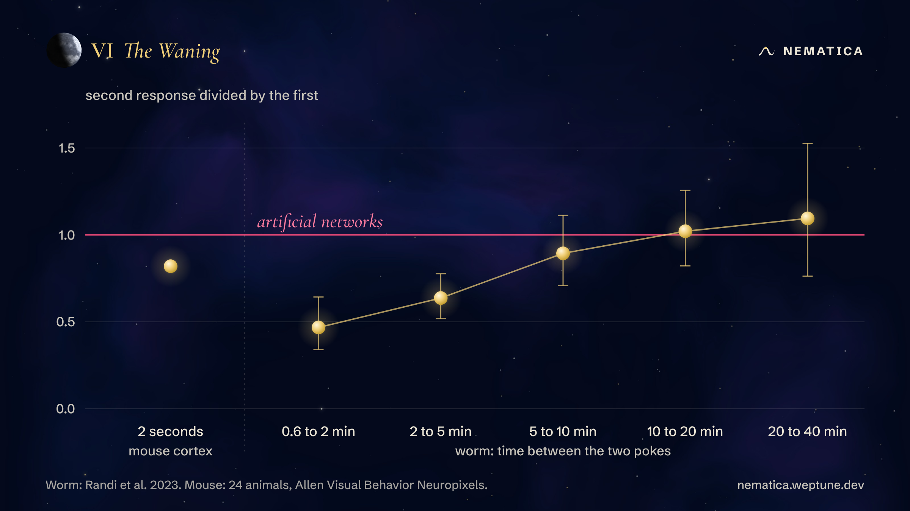
_Figure 9: Second response divided by first. For the worm, against the time between two pokes of the same neuron (bars: the interval from resampling worms). The single point on the left is mouse cortex: later flashes over the first, two seconds apart. Standard artificial networks sit on the line at 1._

That last point is the difficulty. The worm's neuron is poked through a light-gated channel, and such channels can desensitise. This data cannot say whether the neuron tires or the tool does. The estimators I built to separate the two did not hold up on synthetic worms where the answer was known. There is a hint of a neuron component, since a worm neuron also answers a little less after being driven by other neurons with no light involved. The mouse does not settle it either, because in mice with no channel at all, the response to the light alone also tends to shrink over the block.

So The Waning stays as the one place where brains and networks differ and I cannot say why. It may be a property of neurons that networks lack. It may be a property of the experiment.

---

## 10. The Journey: From Still to Moving

**Question VII.** Does a copy built on an animal held still survive once the animal moves?

Everything in Question I was built on worms fixed in place under a microscope and poked with light. The harshest test of the recipe that passed there is a different condition in a different lab: worms crawling freely.

It failed. On 30 freely moving worms (Atanas et al., 2023) the recipe passed 1 of 6 tests of ongoing activity, fewer than a plain linear copy fitted to those worms (3 of 6). An exploratory diagnosis named two things it lacked there:

- **Coupling between neuron types**, the very ingredient that could be dropped on still worms.
- **The lopsided shape of real activity.** Calcium signals are skewed, rising fast and decaying slowly, and a linear model with Gaussian noise produces symmetric ones.

I then registered a single test. Give the recipe exactly those two things, retune nothing else, and score it once on 27 moving worms from a second dataset (Baskoylu et al., 2026) on which no model of this family had been run. For the second ingredient, the model learns its dynamics on the ranks of each neuron's activity, and each simulated worm takes its distribution shapes from one real training worm.

| Copy                                                   | Tests passed of 6, in each run | What it fails                                            |
| :----------------------------------------------------- | :----------------------------- | :------------------------------------------------------- |
| Plain linear copy fitted to rest                       | 3, 3, 3, 3, 3                  | distribution, correlations (too typical), dimensionality |
| The recipe from still worms                            | 2, 1, 2, 1, 3                  | distribution, correlations and lead-lag in every run     |
| **The recipe with both changes**                       | **4, 4, 4, 4, 4**              | timescale and reversal-bout timing                       |
| Coupling only (three runs, not a registered contender) | 5, 4, 5                        | distribution                                             |

Three claims were registered. The failure repeats on new worms: it does. The two changes help: they do, by the smallest margin the rule allowed. The changed recipe reaches the pass mark of 5 of 6: it does not. It lands on 4 in every run.

The pattern of failures is informative. Restoring the coupling brings correlations, dimensionality and lead-lag inside. The shape ingredient does its job on the distribution test, and it also slows the simulated activity enough to fail the timescale and bout-length tests. Each of the six tests is passed by some version. No version passes all six.

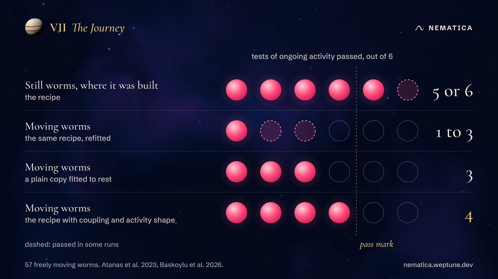
_Figure 10: Tests of ongoing activity passed, out of six: the recipe on the still worms it was built on, the same recipe refitted to moving worms, a plain copy fitted to rest, and the recipe given coupling and activity shape. Dashed marks were passed in some runs only. The dotted line is the pass mark._

What this cannot say is why the original recipe breaks. Both sets of moving worms come from one lab and the still worms from another, so movement and laboratory are confounded. The test worms were also crawling in an arena with a copper barrier that they avoid, which the copies were never told about.

---

## 11. What It Adds Up To

| Question                | An ordinary network or copy                         | What it was given                                 | Then                                             |
| :---------------------- | :-------------------------------------------------- | :------------------------------------------------ | :----------------------------------------------- |
| **I. The Echo**         | echo agreement 0.01 (two real worms: 0.10)          | pokes to learn from                               | 0.09 to 0.11, inside the range of real worms     |
| **II. The Push**        | predicts 77% of regions rise (measured: 12.5%)      | a few brief light pulses                          | predicts 31%; correct direction in 27 of 29 mice |
| **III. The Face**       | individuality 0.78 (real worms: 1)                  | each worm's own dynamics                          | 0.99                                             |
| **IV. The Long Memory** | 1.4 SDs less slow memory than the mouse             | a slow drive, about 6% of each unit's variance    | 0.0 SDs at the median; equivalence not shown     |
| **V. The Inner Light**  | internal share 13% to 86% (mice: 59%)               | nothing                                           | no consistent gap to close                       |
| **VI. The Waning**      | second response equals the first (worm: about half) | nothing yet, because the cause is unknown         | unexplained                                      |
| **VII. The Journey**    | 1 to 3 of 6 tests on moving worms                   | coupling between neuron types, and activity shape | 4 of 6, one short of the pass mark               |

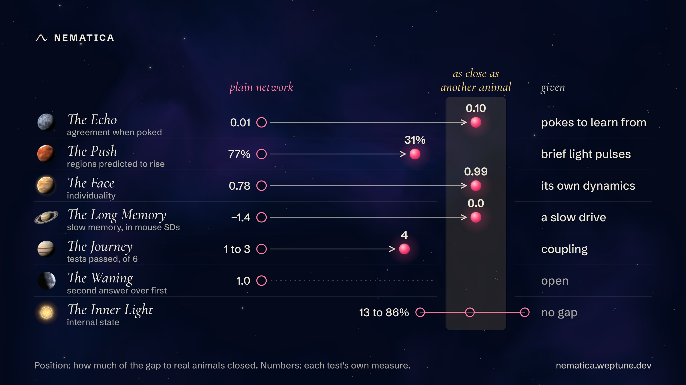
_Figure 11: All seven on one sheet. Each row runs from an ordinary network or copy (ring, on the left) toward the column where a network is as close to an animal as another animal is. The filled mark shows how much of the gap closed once the network was given what the right-hand column names. The numbers are each test's own measure._

Three things stand out to me.

**The gaps were specific.** In five of the six questions where an ordinary network fell short, the shortfall could be named and supplied. What was missing came in two kinds. The first is information the network was never shown: which cell drives which, and with what sign. Resting activity does not contain it, in the worm or in the mouse, so fitting harder to recordings does not recover it, and a small amount of stimulation data does. The second is something the network was not built to carry: a slow state shared across units, differences between individuals, coupling between cell types. An ordinary network lacks these because nothing in its construction or its training asked for them.

**None of what was supplied is biological.** Every gap that closed was closed inside an artificial system: a linear model with a learned table of responses, a random network with a slow input added. Nothing needed spikes, dendrites or chemistry. On these tests, being artificial was not the obstacle. What the network had seen, and what it was built to hold, was.

**Where I expected a difference in kind, there was none.** Internal state was my best candidate for something brains have more of. Mouse cortex landed in the middle of the networks.

I want to be careful about what sort of claim this is. Showing that a property can be put into an artificial network shows that the addition is sufficient to match the measurement. It does not show that the brain produces the property the same way. It also does not give the property to ordinary networks: left alone, they still fail these tests. Both statements are true at once, and both belong in the answer.

And it is a reading of seven results in two species, with one gap unexplained and one closed only most of the way. It is not a law.

---

## 12. What This Does Not Show

- **Two species, public data.** A worm's head and mouse visual cortex, each question on one or two datasets, most of them from a single lab's rig. The Journey cannot separate movement from laboratory.
- **Coarse pass marks.** Inside means within about a quarter of a real animal on that test. Small, consistent errors can pass.
- **Help that was given.** In The Echo and The Push the copy is handed the measured activity of the driven cells. The tests are about how the rest of the brain follows.
- **A small artificial side for the copies.** Mostly linear models, and recurrent networks of a few hundred units. That resting activity does not predict the response to a poke is shown for the models I built. The language models stop at 1 billion parameters, and their Inner Light verdicts depend on a clip length fixed in advance.
- **Not everything was registered.** The Face, the mouse's first-flash drop, the worm recovery curve and the coupling-only recipe are descriptive, and are marked that way above.
- **Sufficiency, not mechanism.** As in the previous section.
- **No peer review.** The checks were mine and those of AI reviewers. None of this has been through a journal.

---

## 13. Test Your Own Network

The part of this I would most like other people to use is the test itself. Anything whose units can be recorded over time, and whose units can be given a brief push, can be run through the worm's protocol and compared with the 113 real worms on eight signatures: how few patterns its resting activity uses, how much of that activity is slow, how much its units move together, its timescale, how far a push spreads, how much a push stands out from ongoing activity, whether a second push gets a smaller answer, and how well a model fitted to its resting activity predicts its responses to pushes.

```sh
git clone https://github.com/Weptune/nematica
cd nematica
pip install -e .

python -m nematica brainlike my_rnn.npz                     # rate RNN weights
python -m nematica brainlike model.onnx                     # any recurrent model, one step at a time (needs onnxruntime)
python -m nematica brainlike my_system.py --class System    # anything you can step and push
```

It needs no recordings, because the worm reference ships as summary numbers, and it writes a report you can open in a browser. Scoring a full copy of the worm brain against the stimulated worms, as in Question I, takes the Randi et al. data and one more command. The repository's benchmark document has the contract a copy must meet.

The site has every result with its caveats, each test as it was written before it ran, and the research log in order: [nematica.weptune.dev](https://nematica.weptune.dev).

---

## Conclusion

I started with a list of parts and the suspicion that one of them, slow internal state, was the real dividing line. The measurements did not support a dividing line of that kind.

What they showed was narrower, and I think more useful. A network that has only watched a brain does not know which cell drives which, and it gets the sign of an inhibitory population wrong in nearly every mouse. A network selected for forecasting turns into the average animal. A random network forgets too fast. A recipe built on still worms breaks on moving ones. Each of these is a measurable distance from a real nervous system, and for each there was a specific thing to add that shortened it, without leaving the world of artificial networks.

That leaves the difference between a brain and a network, as far as these seven tests reach, looking less like a property of the material and more like a list of things the network has not been given. The list is not finished. One item on it, a response that fades when the question is repeated, I cannot yet assign to the neuron or to the tool that poked it.

The question in the title is too large for one project. The method does scale, though. Put both systems through the same instrument, measure the same thing, and count the distance in animals.

---

### References

- Atanas AA, et al. Brain-wide representations of behavior spanning multiple timescales and states in _C. elegans_. _Cell_ 186, 4134 to 4151 (2023).
- Baskoylu S, et al. Whole-brain recordings of freely moving _C. elegans_ at a copper boundary (dataset). Dryad (2026). doi:10.5061/dryad.w9ghx3g4v
- Biderman S, et al. Pythia: a suite for analyzing large language models across training and scale. ICML (2023).
- Cho K, et al. Learning phrase representations using RNN encoder-decoder for statistical machine translation. EMNLP (2014).
- Creamer MS, Leifer AM, Pillow JW. Bridging the gap between the connectome and whole-brain activity in _C. elegans_. bioRxiv (2024).
- Gu A, Dao T. Mamba: linear-time sequence modeling with selective state spaces. arXiv:2312.00752 (2023).
- Hasani R, et al. Closed-form continuous-time neural networks. _Nature Machine Intelligence_ 4, 992 to 1003 (2022).
- Randi F, Sharma AK, Dvali S, Leifer AM. Neural signal propagation atlas of _Caenorhabditis elegans_. _Nature_ 623, 406 to 414 (2023).
- Siegle JH, et al. Survey of spiking in the mouse visual system reveals functional hierarchy. _Nature_ 592, 86 to 92 (2021).
- Allen Institute for Brain Science. Visual Coding Neuropixels (DANDI 000021, 000022) and Visual Behavior Neuropixels (DANDI 000713).
- White JG, Southgate E, Thomson JN, Brenner S. The structure of the nervous system of the nematode _Caenorhabditis elegans_. _Philosophical Transactions of the Royal Society B_ 314, 1 to 340 (1986).
